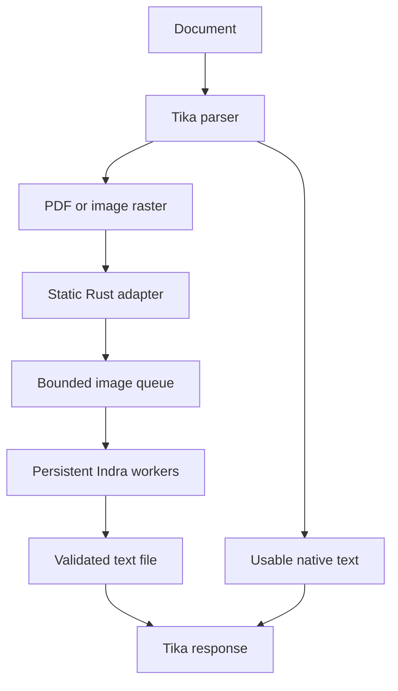

# Tika 3.3.2 + Indra OCR: implementation and measured evidence

Research and validation date: **17 October 2026**.

This report accompanies **Tika_Indra_OCR_Source_and_Evidence.zip**, which contains the full implementation, exact dependencies, Docker/Kubernetes files, release workflows, reproduction scripts, raw observations and license notices. Files named as archive references below are inside its `tika-indra-ocr-client/` directory.

The Rust bridge uses static GNU/glibc linkage. All authored builders are Debian-based; final images are scratch or Debian distroless. Alpine and musl are excluded.

The measured-results section records the executed status and limitations of each native, container, Kubernetes and signing gate. Native CPU-affinity results and extracted image-filesystem checks do not establish container quota performance.

- [Setup and deployment](#setup-and-deployment)
- [Architecture and implementation](#architecture-and-implementation)
- [Measured results and limits](#measured-results-and-limits)


## Setup and deployment

A small Tesseract CLI adapter for Apache Tika, backed by a persistent Indra OCR service. Tika keeps document parsing and PDF rendering. Indra performs OCR on the rendered images. The adapter is dependency-free Rust, statically linked with GNU/glibc. Final images are `scratch` or Debian distroless; builders are Debian-based.

**Recommended starting point:** the 1-CPU profile, FP32 recognition, upstream line batching, 300-DPI grayscale PDF rendering, and caller concurrency one. Select the 2-CPU and math profiles using the measurements for your own documents. There is no demonstrated setting that maximizes accuracy, latency and throughput simultaneously.

This repository was empty when inspected. The implementation and evidence here were created for the requested investigation. Read [the measured results](#measured-results-and-limits) before treating the deployment as production-ready: native execution, image-root execution, container execution and production accuracy are different verification gates.

### What is pinned

| Component | Pin |
|---|---|
| Apache Tika | **3.3.2**, official standard-server JAR verified with SHA-512 |
| Indra package | **0.3.2**, source `3d773aeedc5d79d1d0a2a04007a9075cd71a59f4` |
| Indra models | **v3.1.1**, immutable model revision `ed345c7f158eddbc7dee0c6a7269afb75a94f7e8`; every file SHA-256 checked |
| Rust | **1.99.1**, `x86_64-unknown-linux-gnu`, `+crt-static` |
| Runtime bases | Java 21 / Python 3.13, Debian 13 distroless, immutable image digests |
| Packaged Tesseract baseline | Same Tika/rendering policy, English `tessdata_best` at a pinned commit and SHA-256; native experiments also compare the hashed distribution model |

Exact pins are in deploy/dependencies.lock.json (`deploy/dependencies.lock.json` in the archive), backend/models.lock.json (`backend/models.lock.json` in the archive), the Dockerfiles and the hashed Python lock. The [Apache release catalog](https://release-catalog.apache.org/tika/3.3.2/index.html) confirms the requested Tika release. The Indra findings (`research/indra-findings.md` in the archive) link each upstream claim to its source.

**License:** the adapter is Apache-2.0. Indra's code and its weights have different licenses. The pinned weights include revenue/funding thresholds, competition restrictions, and output attribution/share-alike provisions. Check [the exact model license](https://huggingface.co/datalab-to/indra-ocr/blob/ed345c7f158eddbc7dee0c6a7269afb75a94f7e8/LICENSE) against your intended deployment; an Apache code license does not remove those terms. The GNU static bridge images include glibc notices and exact source/relinking materials in `/relink`; see third-party notices (`THIRD_PARTY_NOTICES.md` in the archive) and relinking (`docs/relinking.md` in the archive).

### Local Docker

Use a Linux/amd64 Docker host with the current Docker Compose plugin. The authored CI uses Docker 29.9.1 and the engine's native BuildKit driver. The deployment allocates 3 GiB to the application stack; the Docker VM/host also needs room for its OS and image builds. ARM emulation is outside this validation.

Build in dependency order from the repository root:

```sh
docker build --platform linux/amd64 -f docker/bridge.Dockerfile -t indra-bridge:dev .
docker build --platform linux/amd64 -f docker/tika.Dockerfile -t tika-indra:dev .
docker build --platform linux/amd64 -f backend/Dockerfile -t indra-backend:dev .

docker compose -f compose.yaml up -d --no-build --wait --wait-timeout 180
python3 scripts/smoke_stack.py
```

The first build downloads dependencies and the locked models. Startup and inference use those local models. The final-stage backend build executes real OCR with math disabled and enabled and fails if its interpreter, native libraries or models do not work.

To evaluate math recognition, change the Indra service's `INDRA_MATH` value from `"0"` to `"1"` in the selected Compose/Kubernetes configuration and recreate it. Both model sets are already in the image. This option needs equation-specific accuracy checks; the local ordinary-text test measured extra cost without an accuracy improvement.

Extract text:

```sh
curl --fail-with-body \
  -H 'Accept: text/plain' -H 'Content-Type: application/pdf' \
  --data-binary @document.pdf -X PUT http://127.0.0.1:9998/tika
```

Tika is published only on host loopback. Indra shares Tika's network namespace and listens only on `127.0.0.1:8081`. The smoke check covers an image, an image-only PDF and a native-text PDF through both `/tika` and `/rmeta/text`.

To switch to the total 2-CPU profile, replace the running stack:

```sh
docker compose -f compose.yaml down
docker compose -f compose.yaml -f compose.2cpu.yaml up -d --no-build --wait --wait-timeout 180
python3 scripts/smoke_stack.py
```

Inspect and stop:

```sh
docker compose -f compose.yaml logs --tail=100
docker compose -f compose.yaml down
```

| Whole application budget | Tika limit | Indra limit | Memory total |
|---|---:|---:|---:|
| 1 CPU | 0.25 CPU | 0.75 CPU | 3 GiB |
| 2 CPUs | 0.50 CPU | 1.50 CPUs | 3 GiB |

Limits include the JVM parent, forked parser, spawned Rust bridge and every Indra child. These conservative per-container partitions cannot borrow idle quota from the other container. Native benchmarks use a common eligible CPU set; they are not measurements of this quota partition. See [resource tradeoffs](#cpu-and-memory-budgets).

#### Compare with Tesseract

```sh
docker compose -f compose.yaml down
docker build --platform linux/amd64 -f docker/tesseract.Dockerfile -t tika-tesseract:dev .
docker compose -f compose.tesseract.yaml up -d --no-build --wait --wait-timeout 180
python3 scripts/smoke_stack.py
```

For the 2-CPU baseline, use `-f compose.tesseract.yaml -f compose.tesseract.2cpu.yaml`. Run one stack at a time. Tesseract receives the same aggregate CPU and memory ceilings. For a fair OCR-only experiment, the Indra stack additionally uses `compose.benchmark.yaml`; the baseline already forces the same 300-DPI OCR-only policy. Production defaults use Tika AUTO.

### Simple Kubernetes deployment

The manifests create one Deployment with two containers in one Pod and a ClusterIP Service. They use non-root users, read-only roots, dropped capabilities, bounded temporary storage and separate startup/readiness/liveness checks. `Recreate` avoids temporarily doubling the application budget during an update, with a corresponding availability gap.

On a local cluster, load `tika-indra:dev` and `indra-backend:dev` into that cluster's image store using the cluster's normal image-import command. On a registry-backed cluster, set both images to your **verified release digests** in the selected Kustomize overlay:

```yaml
images:
  - name: tika-indra:dev
    newName: ghcr.io/YOUR_OWNER/tika-indra-tika
    digest: sha256:YOUR_VERIFIED_TIKA_DIGEST
  - name: indra-backend:dev
    newName: ghcr.io/YOUR_OWNER/tika-indra-backend
    digest: sha256:YOUR_VERIFIED_BACKEND_DIGEST
```

Then deploy one budget:

```sh
kubectl apply -k deploy/overlays/1cpu
kubectl rollout status deployment/tika-indra --timeout=300s
kubectl port-forward service/tika-indra 9998:9998
```

Use `deploy/overlays/2cpu` to replace that Deployment with the larger profile. Run `python3 scripts/smoke_stack.py` through the forwarded port. Kubernetes does not automatically verify Cosign signatures; verify before applying, or add a cluster admission policy if continuous enforcement is required.

### Signed releases and verification

The GitHub Actions workflows pin actions to full commit SHAs. Pull requests get read-only permissions. Pushes to `main` and version tags run the reusable CI gate, build candidates with commit-addressed tags, test the **published digests** in Compose and Kubernetes at both CPU budgets, and only then sign and attest them through GitHub OIDC. Host-installed, checksum-pinned Syft produces the SPDX SBOM; Cosign signs and verifies both the image and SBOM. BuildKit emits provenance. The digests are immutable; a commit-addressed tag can change on a rerun. New main pushes cancel superseded runs, so an interrupted candidate may be unsigned. Use a successful run's digest artifact and verify every digest before deployment.

Use the digest artifact from your completed release, not an assumed image name or a mutable tag:

```sh
IMAGE='ghcr.io/YOUR_OWNER/tika-indra-tika@sha256:YOUR_DIGEST'
IDENTITY='https://github.com/somehowchris/tika-indra-ocr-client-/.github/workflows/release.yml@refs/heads/main'
## For a version-tag run, use its exact @refs/tags/YOUR_TAG identity instead.

cosign verify --certificate-identity "$IDENTITY" \
  --certificate-oidc-issuer https://token.actions.githubusercontent.com "$IMAGE"
cosign verify-attestation --type spdxjson --certificate-identity "$IDENTITY" \
  --certificate-oidc-issuer https://token.actions.githubusercontent.com "$IMAGE"
```

No registry publication or successful signing run is implied by the presence of these workflows. Their execution status is recorded in [results](#measured-results-and-limits).

The release also runs two 180-request signed-container comparisons (`benchmarks/README.md` in the archive): the shared CPU configuration and the exact deployment CPU partitions. Both enforce total CPU limits of one/two and 3 GiB memory through a verified parent cgroup. Their raw artifact and job summary must complete before the release digest artifact is published. Documentation and retained-evidence-only main pushes do not rebuild unchanged runtime images; version tags still run the release gates.

### Where to go next

- [Architecture, exact Tika contract and optimization decisions](#architecture-and-implementation)
- [Measured results and remaining acceptance gates](#measured-results-and-limits)
- Reproduce the benchmarks and supply your own corpus (`benchmarks/README.md` in the archive)
- Backend API, model validation and operational limits (`backend/README.md` in the archive)
- Primary-source Indra research (`research/indra-findings.md` in the archive)
- Benchmark methodology and interpretation (`research/benchmark-methodology.md` in the archive)

Start with the provided fixture suite, then a held-out sample of your own documents. Include per-script and per-document-type results, errors, reading order, memory peaks, startup, queueing and the exact deployed image digests in the acceptance decision.


## Architecture and implementation

### Selected integration

Keep Apache Tika 3.3.2 and its document-format coverage. Replace only the executable invoked by `TesseractOCRParser`: a small Rust program accepts the exact configured Tika CLI, uploads a rendered image to a resident Indra worker, validates the complete response, and writes the output file Tika expects.



This preserves the upstream OCR pipeline while avoiding model loading for every page. It delivers plain text through Tika. Indra's structured JSON boxes, confidence data, HTML tables and Markdown are not exposed by this narrow compatibility interface. Adding them should use an explicit metadata/schema extension rather than pretending plain text preserves that structure.

#### Alternatives evaluated

| Approach | Benefits | Cost or limitation | Decision |
|---|---|---|---|
| Keep Tesseract with `tessdata_best` | Mature language models; smallest change | Baseline CPU/latency cost; workload-dependent quality | Retained as a real comparison and rollback path |
| Point Tika directly at `indra-ocr` | Superficially simple | Different CLI/output contract; repeated process/model initialization | Incompatible without an adapter |
| Rust CLI adapter + resident upstream Indra | Small, reviewable change; preserves inference behavior; model reuse | Process and loopback transport overhead; text-only integration | Implemented |
| Custom Java Tika parser | Can publish structured metadata and use Java HTTP pooling | Additional Tika plugin lifecycle, packaging and compatibility surface | Consider when boxes/layout become a requirement |
| Route PDFs directly to Indra's converter | Native text/hybrid path and upstream page scheduling | A second document-routing architecture; changes extraction semantics | Separate future evaluation |
| Rewrite detection, geometry, recognition and layout in Rust | Potentially one native service and fewer boundaries | Large parity burden; ORT/native code still needs packaging; no measured speed benefit yet | Not justified by current evidence |
| Cross-request crop batching | May improve utilization on large deployments | Requires detection/crop queueing, fair deadlines, result scattering and independent accuracy checks | Not implemented or claimed |

The upstream [pipeline](https://github.com/datalab-to/indra/blob/3d773aeedc5d79d1d0a2a04007a9075cd71a59f4/indra_ocr/pipeline.py), [document conversion](https://github.com/datalab-to/indra/blob/3d773aeedc5d79d1d0a2a04007a9075cd71a59f4/indra_ocr/document.py) and [parallel execution](https://github.com/datalab-to/indra/blob/3d773aeedc5d79d1d0a2a04007a9075cd71a59f4/indra_ocr/parallel.py) support the capability distinctions above. The decisions are engineering judgments, not measured rankings of unimplemented alternatives.

### Exact Tika contract

The configured invocation is:

```text
/opt/indra/tesseract INPUT OUTPUT_BASE --psm 3 -c page_separator= -c preserve_interword_spaces=0 txt
```

The executable writes `OUTPUT_BASE.txt`. Returning text only on stdout does not satisfy Tika. The availability probe invokes the executable without arguments; that probe succeeds locally without requiring an already-running backend. Actual readiness is a separate check.

`--tika-ready` checks both the Indra backend and Tika HTTP server. The Tesseract comparison uses `--tika-server-ready`, which checks only Tika's HTTP listener. Its Compose healthcheck therefore waits for Java to serve requests. Startup probes may retry a connection reset while a listener starts; measured extraction requests are never retried to hide failures.

Set `language` to an empty string, `preloadLangs=false`, `outputType=txt`, `pageSegMode=3`, `enableImagePreprocessing=false`, and `applyRotation=false`. Indra applies its own layout/orientation path. The bridge rejects language hints, unsupported page modes, hOCR and unimplemented flags rather than silently accepting different semantics. The supported interface intentionally follows the inspected [Tika 3.3.2 OCR parser](https://github.com/apache/tika/blob/b8a6916eab70ccdb5d4551c69be1a46af29c2cff/tika-parsers/tika-parsers-standard/tika-parsers-standard-modules/tika-parser-ocr-module/src/main/java/org/apache/tika/parser/ocr/TesseractOCRParser.java).

The two accepted `-c` defaults are compatibility tokens, not configurable Indra layout controls. Indra determines word/paragraph spacing; its multi-frame TIFF API retains `\n\f\n` between frames even though Tika's Tesseract invocation supplies `page_separator=`. Treat exact whitespace and page delimiters as an explicit output difference and use the strict scores when those bytes matter.

The XML timeout property is `timeout`, measured in seconds. The implemented ordering is backend **60 s**, bridge **70 s**, Tika OCR **75 s**, and Tika task watchdog **300 s**. Keep `noFork=false`: the watchdog can replace a stuck parser process. Backend deadlines terminate a stuck native worker, and unsuccessful replacement or idle-child death makes the supervisor exit nonzero. Readiness alone would only remove traffic.

The bridge streams at most 20 MiB of encoded input and accepts at most 4 MiB of UTF-8 text. Headers are bounded to 16 KiB. It requires a successful, length-delimited plain-text response, rejects malformed/truncated responses, and creates a new output file only after full response validation. Existing output is never overwritten. A correctly recognized blank page can produce a successful empty file; an error cannot be converted into that success case.

#### PDF semantics

Production uses Tika AUTO with its `better` heuristic. In the inspected source, OCR is triggered for very little native text or many unmapped Unicode characters. A mixed page with sufficient native text can still leave text embedded inside a scanned region unrecognized. Benchmark configuration forces `ocr_only` and holds rendering at 300-DPI grayscale for both engines. Full-page and inline-image OCR are not enabled together, avoiding duplicate extraction. See [PDF configuration](https://github.com/apache/tika/blob/b8a6916eab70ccdb5d4551c69be1a46af29c2cff/tika-parsers/tika-parsers-standard/tika-parsers-standard-modules/tika-parser-pdf-module/src/main/java/org/apache/tika/parser/pdf/PDFParserConfig.java) and [PDF processing](https://github.com/apache/tika/blob/b8a6916eab70ccdb5d4551c69be1a46af29c2cff/tika-parsers/tika-parsers-standard/tika-parsers-standard-modules/tika-parser-pdf-module/src/main/java/org/apache/tika/parser/pdf/AbstractPDF2XHTML.java).

Tika processes full-page OCR synchronously. One multi-page PDF does not automatically feed concurrent page requests to this service. To exercise two backend workers, send independent documents concurrently. Indra's own `convert_many` page scheduler is a different integration path.

`/rmeta/text` can return HTTP 200 while metadata contains `X-TIKA:EXCEPTION:container_exception`; clients must inspect exception and write-limit fields. A successful process that fails to create its output can also produce empty extraction. These cases were checked against the real 3.3.2 server with labelled contract stand-ins; the smoke script verifies actual content as well as status. `pdf:ocrPageCount` counts attempts and is not sufficient proof that the backend completed OCR.

### Accuracy and batching

The default profile explicitly keeps FP32 recognition, orientation, script selection, adaptive detection, reading order and every published standard model. The pinned snapshot has no released `rec.int8.onnx` or `mask.onnx`; neither is invented as a performance feature. The backend checks the exact manifest at startup and fails on missing or modified models.

Indra batches line crops of the same recognition group and similar width. Ordinary recognition uses tensors `[B,1,32,W]` with width aligned to eight and at most 64 lines. Grouping treats widths below 64 as 64, limits their ratio to 1.3, and checks `count × max(width, 64) ≤ 40,960`. The 64-pixel floor applies to grouping, not tensor width; final alignment can add up to seven columns per line beyond the grouping estimate. Short pages often yield batches much smaller than 64. The queue and two worker processes do not fuse independent requests. [Batch construction](https://github.com/datalab-to/indra/blob/3d773aeedc5d79d1d0a2a04007a9075cd71a59f4/indra_ocr/rec_preproc.py)

`INDRA_BATCH_METRICS=1` records actual tensor shapes, useful versus padded columns, stage times, queue time and worker identity. Compare `INDRA_RECOGNITION_BATCH=1` with 64 on identical inputs. Instrumentation has cost and is labelled in the results. Never call a queue-size increase an inference batching improvement.

`INDRA_MATH=1` enables the extra models already included in the locked image. It may improve formula extraction while altering ordinary numeric/table text and increasing latency. Correctly loading the math profile is distinct from proving mathematical transcription accuracy. The publisher's [math implementation and release results](https://github.com/datalab-to/indra/blob/3d773aeedc5d79d1d0a2a04007a9075cd71a59f4/CHANGELOG.md) support testing this profile separately.

OCR scripts are Latin, Cyrillic, Greek, Devanagari, Bengali and Chinese. Existing PDF text can cover more scripts, which is not evidence of OCR support. Handwriting, vertical text, degraded pages and complex tables need explicit acceptance slices. A global CER can hide a complete failure for a small language group. See the checked language/limitation report (`research/indra-findings.md` in the archive).

### Rust performance and static linkage

The Rust code uses a concrete error enum and statically resolved generic parameters. It contains no `dyn`, `.clone()` or `.to_owned()`, has no third-party crates, forbids unsafe code and denies the relevant Clippy lints. This source-level property is not a claim that the standard library or native OCR stack has no allocations or copies.

| Boundary | Deliberate memory work |
|---|---|
| CLI and file paths | Owned OS argument/path buffers moved into the command |
| Image upload | Bounded streaming via `io::copy`; no full image buffer in Rust |
| Response | One bounded response vector, validated as borrowed UTF-8 before file creation |
| HTTP parsing | Reused bounded header-line storage and an 8 KiB buffered reader |
| Python worker | Encoded-body buffering and explicit process IPC; NumPy views the compressed bytes |
| OCR model | Image decoding, crop resizing/padding and native inference allocations |

`release` uses optimization level 3, thin LTO, one codegen unit, panic abort, stripped symbols, no incremental compilation and retained overflow checks. `maxperf` changes only to fat LTO and is a measured candidate, not a universal speed claim. `profiling` retains symbols. Build the static GNU target on Debian:

```sh
RUSTFLAGS='-C target-feature=+crt-static' \
  cargo build --locked --offline --jobs 2 --release --target x86_64-unknown-linux-gnu
python3 scripts/check_static.py target/x86_64-unknown-linux-gnu/release/indra-tesseract
```

The ELF gate requires both no `PT_INTERP` and no `DT_NEEDED`; the tool executions must themselves succeed. A static PIE can still have ELF type `DYN`. The release binary was also executed as UID 65532 inside a filesystem containing only that executable. The [Rust linkage reference](https://doc.rust-lang.org/reference/linkage.html#static-and-dynamic-c-runtimes) explicitly recommends inspecting the generated artifact; [Cargo profiles](https://doc.rust-lang.org/cargo/reference/profiles.html) define the optimization controls.

Only the Rust adapter is a fully static executable. The supported Indra Python/ONNX runtime and Tika JVM are dynamic glibc runtimes inside distroless. Rebuilding the entire model/document stack as static Rust would be a separate port. No Alpine-based images or alternative libc toolchains are used by the authored build paths.

Static glibc also changes redistribution packaging. The bridge image includes `/relink`: the exact installed glibc source package and Debian patches, application source/build files, notices and hashes. Tika copies that directory and the baseline inherits it. This costs additional image bytes; the measured 1.23-MB figure refers only to the native bridge executable. The source collector rejects mismatched archives. See relinking instructions (`docs/relinking.md` in the archive) and third-party notices (`THIRD_PARTY_NOTICES.md` in the archive); this bundle does not replace the model license or every native dependency's terms.

`target-cpu=native`, PGO, alternate allocators, quantization and alternate execution providers are not enabled speculatively. The bridge is dominated by process/file/transport work; meaningful optimization needs measured service-level benefit and unchanged text. A native CPU target also narrows where the resulting artifact can run.

### CPU and memory budgets

The standard Compose/Kubernetes profiles use per-container CPU ceilings whose sum is one or two. Tika's budget includes the Java parent, forked parser and Rust children; Indra's includes the Python parent and all model workers. Requests equal limits in the basic Kubernetes manifests. Memory is 1 GiB for Tika and 2 GiB for Indra, matching the baseline's total 3 GiB.

Hard partitions simplify accounting but can waste idle capacity: during OCR, Indra cannot borrow Tika's unused quota. The native affinity experiment gives both processes the same eligible CPU set, so its timings do not predict those partitions exactly. The signed-image benchmark wrapper records leaf cgroup counters and can use a preconfigured shared parent budget; it never adds parent and child counters together. [Docker CPU controls](https://docs.docker.com/engine/containers/resource_constraints/) and [Kubernetes resource accounting](https://kubernetes.io/docs/concepts/configuration/manage-resources-containers/) define these distinctions.

The hosted release measures two separate CPU policies. `shared` gives each container access to the full one-/two-CPU parent budget. `deployment` preserves the original 25%/75% Tika/Indra split and checks every leaf quota exactly. Both use the same verified parent CPU and memory ceilings, fixture order, inference settings and independent driver CPU; their results are never pooled.

Kubernetes also offers Pod-level CPU budgets through `PodLevelResources` (beta since 1.34, enabled by default in current documentation). This can let containers share idle resources under a single total limit. It is a worthwhile comparison on a cluster that supports it, with container CPU limits removed and the Pod limit retained. Cluster admission can modify resources, so inspect the admitted Pod and actual cgroup. The portable base manifests do not depend on that feature or claim its performance without a cluster run.

For one CPU, one Indra worker with one intra-op thread avoids thread oversubscription. At two CPUs, compare **two workers × one thread with two requests** against **one worker × two threads with one request**. The latter may improve individual latency while the former targets throughput; both can also lose to the one-CPU profile on a constrained or variable host. Explicit OpenMP/BLAS/OpenCV/ORT counts matter because CPU-count discovery and session spinning do not implement a whole-stack quota. [ORT threading](https://onnxruntime.ai/docs/performance/tune-performance/threading.html)

The Tika parent heap is capped at 128 MiB, the parser heap at 512 MiB, and its temporary filesystem at 256 MiB. These do not sum to a safe universal memory bound: native libraries, thread stacks, page rendering and file cache consume additional memory. Indra's 25-million decoded-pixel limit is aggregate across at most 16 TIFF frames; it is not an original-PDF page or byte limit.

The backend admission queue cannot bound requests already accepted and rendered by Tika. Start with caller concurrency one, measure two in the 2-CPU profile, and impose original-document size/page limits in the submitting application or ingress. A memory cap provides an enforcement boundary, not a guarantee against OOM for every valid input. No unverified Tika HTTP concurrency property is presented as a fix.

### Release supply chain

Images and model files are pinned independently. Python dependencies use package hashes and binary-only installation. Debian packages come from a fixed signed snapshot; disabling snapshot expiry checking does not disable signature verification. Runtime model download is disabled. These controls provide traceability; they do not claim byte-for-byte reproducible container builds.

CI runs Rust checks, backend/benchmark invariants, image builds, Compose checks and a real kind deployment. Each final image executes its relevant native startup check during its build. Pushes to `main` and version tags invoke that same CI before publishing candidates. The release workflow tests the exact published candidate digests in Compose and Kubernetes at both CPU budgets before signing. Docker 29 exports attached provenance even for one selected platform; the archive gate verifies each artifact's subject, empty non-runnable configuration and payload hashes while allowing exactly one runnable image. The Kubernetes gate records admitted resources and actual cgroup-v2 CPU and memory ceilings, image IDs, UID/GID, read-only roots and memory-backed temporary storage. The control plane and smoke client are outside the application budget; this gate makes no throughput claim. The workflow uses least-privilege job permissions, full action SHAs, GitHub OIDC, Cosign, host Syft and BuildKit provenance. Correctness and deployment failures prevent signing; the subsequent signed-image benchmarks must also pass before the workflow publishes its final digest artifact. See [GitHub hardening](https://docs.github.com/en/actions/security-for-github-actions/security-guides/security-hardening-for-github-actions), [Docker attestations](https://docs.docker.com/build/ci/github-actions/attestations/) and [Cosign container signing](https://docs.sigstore.dev/cosign/signing/signing_with_containers/).

Action pinning does not replace ongoing updates. Dependabot opens proposed changes; rerun correctness, model-integrity, differential-output and resource tests before accepting an update. Protect release tags in repository policy. Verification must match the exact workflow identity and issuer, not a permissive identity regular expression.

Kubernetes image verification distinguishes three OCI objects: the signed registry index, its selected Linux/amd64 manifest and that manifest's configuration. Docker's containerd image store reports a manifest/index ID, while CRI reports a configuration ID. The gate selects and exports the runnable platform once, checks its manifest/configuration hashes and sizes, imports that same archive, and compares the corresponding CRI configuration. Registry provenance remains attached to the original signed index. The [Docker identity implementation](https://github.com/moby/moby/blob/b26fb77d3e7b01f9d21b89539c1ab428f5ca431f/daemon/containerd/image_inspect.go) and [kind import implementation](https://github.com/kubernetes-sigs/kind/blob/407a9675e6d9af1200b5f57f9ca52ec6cdacce74/pkg/cluster/nodeutils/util.go) explain the distinction; actual Docker transport checks (`validation/kubernetes-image-identity.json` in the archive) cover the verification code.


## Measured results and limits

Measured on **2026-10-17**. Indra is a promising replacement for this workload: it improved measured throughput, handled the two-column fixture well, and worked through the exact Tika 3.3.2 integration. The evidence supports a controlled migration trial. It does **not** establish a universal accuracy winner, a production tail-latency guarantee, or the speed of the supplied Docker CPU partitions.

Start with one worker, one inference thread, standard FP32 models, upstream line batching, Tika AUTO and 300-DPI grayscale rendering. Retain the Tesseract image as the comparison and rollback path. Choose a larger worker/thread or math profile only after a matched test on the documents that matter.

### What was actually proved

| Gate | Result and scope |
|---|---|
| Exact Tika 3.3.2 CLI, PDF configuration and error behavior | Exercised with the official checksum-verified server JAR; contract evidence (`validation/tika-contract.json` in the archive) |
| Rust build and protocol | Four unit tests, strict Clippy, GNU static ELF checks, ten real subprocess/HTTP protocol tests and combined health checks passed; build (`validation/rust-checks.json` in the archive), protocol (`validation/bridge-protocol.json` in the archive), health (`validation/gnu-bridge-health.json` in the archive) |
| Real Indra service | Twelve input/HTTP tests and two actual worker-death/replacement-failure tests passed with locked models; results and logs (`validation/backend-real/tests.json` in the archive) |
| Whole-stack native performance | Matched one-CPU and two-CPU process-tree affinity experiments, actual OCR, retained request outputs, three timing repetitions and no observed affinity escape in accepted primary runs |
| Exact runtime filesystem compatibility | Pinned Java 21 and Python 3.13 distroless filesystems executed with the real bridge/models, non-root IDs, read-only roots and bounded noexec tmpfs; Indra and Tesseract stacks both passed image, scanned-PDF and native-PDF checks at one and two eligible CPUs; rootfs evidence (`validation/rootfs` in the archive) |
| Docker application execution / CFS enforcement | The [third hosted run](https://github.com/somehowchris/tika-indra-ocr-client-/actions/runs/39067251636) built all four images and passed both Indra and Tesseract Compose profiles. It also pulled and passed those checks on all published candidate digests. Shared-parent and deployment-partition timing matrices remain pending; exact run evidence (`validation/ci/39067251636/README.md` in the archive). |
| Kubernetes deployment and admitted resource limits | Both live one- and two-CPU deployments passed with the locally built final images, including admitted resources and kernel CPU/memory limits; measured gate output (`validation/ci/39067251636/kubernetes-verification-ci/summary.json` in the archive). The published-image gate found an OCI provenance export validation defect, now reproduced and fixed; its rerun remains pending. |
| GitHub Actions, published signatures and SBOM attestations | The third hosted run passed the entire reusable verification job, distroless base signature checks and publication of all four exact candidate digests. Signing, SBOM attestation and the signed-container matrices were correctly skipped after the published-image Kubernetes gate failed. The validator now verifies attached OCI provenance subjects and payload hashes; actual Docker reproduction (`validation/ci/39067251636/oci-provenance-reproduction.json` in the archive). Failed attempts remain in validation/ci (`validation/ci` in the archive). |
| Production accuracy, long documents, overload, p99 and memory-limit survival | Not established by the small fixture suite; concrete acceptance measurements appear below |

The retained benchmark package contains **786 successful accepted timed requests across 13 completed experiments**, including the native-PDF bypass controls. It records zero failed accepted requests and no observed affinity escapes in those runs. Invalid or blocked attempts remain separately identified. The 1,200-call bridge microbenchmark and correctness/fault checks are additional, distinct evidence.

### Hardware and fairness

The guest identifies an **Intel Xeon Platinum 8370C at 2.80 GHz**, x86-64. It exposes nine logical CPUs, an eight-CPU host cgroup quota and 8 GiB of host cgroup memory. The OCR experiment uses **CPU 2 only** or **CPUs 2 and 3 together** for the complete application. The load generator and process monitor use CPU 8. The guest reports distinct core IDs for CPUs 2 and 3, with no exposed sibling; this does not prove exclusive physical cores on the host.

Every observed Tika parent/child JVM, Rust OCR subprocess, Python supervisor and Indra worker/thread must stay inside the selected application CPU set. This bounds simultaneous execution to one or two logical CPUs. It is **inherited Linux affinity**, not an isolated one/two-CPU CFS quota. Other validation work used different CPU sets, but the shared VM, cache, storage and memory bandwidth can still vary. Per-repetition timings expose substantial variance.

The raw comparison uses the same encoded image bytes. Tesseract starts a CLI process per request; Indra keeps models resident behind HTTP. Those are the actual integration paths, so the result includes the benefit of model residency and is not a pure neural-kernel comparison. The Tika comparison uses the same JAR, input documents, grayscale 300-DPI rendering, OCR-only policy and JVM settings for both engines. Native-text AUTO is measured separately.

Native timing uses Python **3.13.16**, Java **17.0.20** and Tesseract **5.3.4**. The verified final-image filesystems use Python **3.13.5**, Java **21.0.12.1+1** and Tesseract **5.5.0**. Native Tika has a 256-MiB parent heap and 512-MiB parser heap; deployment defaults use 128/512 MiB. The native two-CPU throughput experiment uses two one-thread workers and two concurrent requests. Image-root smoke checks establish compatibility of final runtimes; they do not substitute for a performance rerun of those versions and resource policies.

The image-root smoke tests used one Indra worker/one thread at both affinity masks. The recommended two-worker deployment setting comes from the native throughput experiment. The GNU bridge in the smoke check is the native-built binary whose hash is recorded; no Docker-produced bridge digest is claimed. Source/relink packaging was added after the inference checks and is a separate build gate. None of these checks is a byte-for-byte execution of a completed Docker build.

### Main performance results

Throughput is successful pages divided by the measured request-batch makespan, excluding startup, the designated first client warmup and offline accuracy scoring. Latency includes the complete client request path. One-CPU runs use concurrency one; two-CPU throughput runs use concurrency two. A higher concurrency can raise throughput and individual request latency together.

#### Whole Tika stack: distribution Tesseract model

Each row covers **15 unique cases × 3 timing repetitions = 45 successful requests**, with zero request failures. The corpus contains twelve images, two scanned PDFs and one native PDF deliberately forced through OCR for this comparison.

| Total eligible CPUs | Engine | Pages/s | p50 ms | p95 ms | CER | WER |
|---:|---|---:|---:|---:|---:|---:|
| 1 | Tika + Tesseract distribution English | 0.917 | 993.3 | 2,407.4 | 2.1739% | 4.5190% |
| 1 | Tika + Indra | **1.705** | **385.3** | **1,586.5** | **0.1233%** | **0.8017%** |
| 2 | Tika + Tesseract distribution English | 1.058 | 1,653.3 | 3,697.6 | 2.1739% | 4.5190% |
| 2 | Tika + Indra | **1.895** | **801.8** | **2,233.4** | **0.1233%** | **0.8017%** |

These matched throughput point estimates favor Indra by **1.86× at one CPU** and **1.79× at two CPUs**. Indra's one-to-two-CPU increase is about **11%** in this series, while individual latency rises with concurrency. The distribution model is much faster than `tessdata_best`, so these are the more useful starting figures for an existing default-Tesseract installation. Its English model is locked by SHA-256 `7d4322bd2a7749724879683fc3912cb542f19906c83bcc1a52132556427170b2` in the experiment metadata.

Sources: one CPU (`benchmarks/results/tika-stock-1/summary.json` in the archive), two CPUs (`benchmarks/results/tika-stock-2/summary.json` in the archive), all requests and per-run rates (`research/benchmark-results.md` in the archive).

#### Whole Tika stack: `tessdata_best` model

This earlier paired series uses the same 15-case design and 45 successful requests per row. It compares the slower best-model baseline with its own contemporaneous Indra runs; rates from the two series are not pooled into a single speedup.

| Total eligible CPUs | Engine | Pages/s | p50 ms | p95 ms | CER | WER |
|---:|---|---:|---:|---:|---:|---:|
| 1 | Tika + Tesseract `tessdata_best` | 0.402 | 2,354.6 | 4,501.0 | 2.1851% | 4.4461% |
| 1 | Tika + Indra | **1.503** | **443.4** | **1,873.4** | **0.1233%** | **0.8017%** |
| 2 | Tika + Tesseract `tessdata_best` | 0.376 | 4,302.6 | 10,990.5 | 2.1851% | 4.4461% |
| 2 | Tika + Indra | **1.790** | **812.7** | **2,455.4** | **0.1233%** | **0.8017%** |

These are approximately **3.74×** and **4.76×** throughput point estimates against the best-model baseline. Indra's own one-to-two-CPU increase is only about **19%** here. Tesseract's two-CPU aggregate is lower than its one-CPU result; one request took approximately 27.9 seconds. The three Tesseract two-CPU repetition rates range from 0.286 to 0.485 pages/s, making any general scaling claim inappropriate.

In both series, p95 values are descriptive order statistics from 45 requests. They are too small a sample for a production tail-latency promise. Raw JSON also reports p99 with an explicit warning. Between-series variation in Indra's rates is another reason to retain paired comparisons and avoid extrapolating these shared-host point estimates.

Sources: one CPU (`benchmarks/results/tika-1/summary.json` in the archive), two CPUs (`benchmarks/results/tika-2/summary.json` in the archive), all requests and per-run rates (`research/benchmark-results.md` in the archive).

#### Direct image paths

Each row covers twelve unique images, 36 successful timed requests and zero failures.

| Total eligible CPUs | Engine | Pages/s | p50 ms | p95 ms | CER |
|---:|---|---:|---:|---:|---:|
| 1 | Tesseract distro English | 0.988 | 898.6 | 2,016.9 | 2.8542% |
| 1 | Tesseract best English | 0.509 | 2,249.1 | 3,753.8 | 2.8691% |
| 1 | Indra | **2.116** | **430.2** | **925.6** | **0.1195%** |
| 2 | Tesseract distro English | 1.394 | 1,533.5 | 2,291.2 | 2.8542% |
| 2 | Tesseract best English | 0.552 | 3,944.9 | 6,703.1 | 2.8691% |
| 2 | Indra | **2.968** | **681.2** | **925.3** | **0.1195%** |

Sources: one CPU (`benchmarks/results/raw-1/summary.json` in the archive), accepted two-CPU run (`benchmarks/results/raw-2-verified/summary.json` in the archive). The initial two-CPU attempt was rejected because process sampling caught `taskset` before it applied the workload affinity. It is preserved as an invalid attempt and excluded from these tables; the harness now waits for the actual workload mask before attaching its sampler.

### Accuracy: the near-tie hidden by the aggregate

The synthetic set has only **five source-document clusters**. Multiple images and PDFs are renditions of the same short operations report. Repeating those inputs three times increases timing observations, not independent accuracy evidence.

The headline error gap is concentrated in the two-column reading-order case and a multilingual Latin challenge. The baseline explicitly uses **English** trained data. Reading order is a real extraction concern, but this is not a comparison of every engine's best language-specific configuration.

After excluding the two challenge categories and the blank page:

| Matched ordinary-text subset | Reference codepoints | Tesseract distro errors | Tesseract best errors | Indra errors |
|---|---:|---:|---:|---:|
| Raw image paths | 6,101 | 9 (0.1475%) | 8 (0.1311%) | 7 (0.1147%) |
| Tika OCR-only paths | 8,333 | 12 (0.1440%) | 11 (0.1320%) | 10 (0.1200%) |

**Indra differs from `tessdata_best` by one character, and from the distribution model by two characters, on this ordinary-text subset.** This is useful evidence of output stability on those fixtures, not a broad accuracy superiority claim. The cluster bootstrap intervals in `summary.json` are exploratory because five clusters cannot represent production diversity.

CER is character edit distance divided by reference Unicode codepoints after NFC normalization and whitespace collapse; WER uses reference words. Case, punctuation and reading order remain significant. These are codepoints, not grapheme clusters. Strict whitespace-sensitive scores are also retained. Tika can emit formatting whitespace for a blank page: the normalized blank false-positive count is zero while strict whitespace output is nonempty. Normalization is explicit and must match the consuming application's needs.

#### Public legacy scans, reported separately

Three pinned upstream Tesseract regression scans provide a second, non-synthetic diagnostic. Two include historical UNLV transcription markers and reading-order conventions. Their references have not been manually adjudicated into production-quality ground truth. Call these **legacy transcript disagreement**, not a clean estimate of production OCR accuracy.

| Engine | 1-CPU pages/s | 2-CPU pages/s | CER | WER |
|---|---:|---:|---:|---:|
| Tesseract distro English | 0.287 | 0.447 | 8.2484% | 13.7378% |
| Tesseract best English | 0.118 | 0.165 | 8.1999% | 13.2497% |
| Indra | **0.786** | **1.166** | **5.6890%** | **12.5523%** |

There were nine successful timed requests per engine at each budget, with no failures. Accuracy was unchanged across CPU budgets. The smaller WER difference is worth keeping alongside CER. The archive includes numeric observations, source hashes and retrieval code; it omits the scanned articles, their transcripts and predicted article text. Results (`research/benchmark-results.md` in the archive), immutable corpus metadata (`benchmarks/public-regression.lock.json` in the archive).

### What the optimization experiments say

#### Dynamic line batching

The backend uses upstream batching within each page. It sorts line crops by width, separates recognition scripts, and limits count and a width-based estimate of padded work. The estimate precedes rounding tensor width to a multiple of eight; it is not an exact final tensor-area limit. There is no cross-request tensor fusion or artificial batching delay. The [pinned preprocessing code](https://github.com/datalab-to/indra/blob/3d773aeedc5d79d1d0a2a04007a9075cd71a59f4/indra_ocr/rec_preproc.py) and [pipeline](https://github.com/datalab-to/indra/blob/3d773aeedc5d79d1d0a2a04007a9075cd71a59f4/indra_ocr/pipeline.py) are the authority for this behavior.

On six matched synthetic fixtures, three repetitions each:

| One-CPU setting | Pages/s | CER | Observed tensor batches |
|---|---:|---:|---|
| Recognition batch ceiling 1 | 2.802 | 0.1346% | B1 only |
| Recognition batch ceiling 64 | 2.986 | 0.1346% | B1–B9 |

The larger ceiling improved the aggregate point estimate by **6.55%**, with identical text. Per-run rates overlap substantially: 2.286–3.200 versus 2.917–3.095 pages/s. This does not prove a repeatable 6.55% improvement on another workload.

Actual shape instrumentation observed B1–B9 on the primary synthetic raw run, B1–B10 through Tika, and real **B64** calls on the public scans. Padding accounted for approximately 8.57%, 8.62% and 11.80% of the corresponding observed recognition/script tensors. These totals include warmups. In the batch ablation, padding rose from 0.81% with single-line batches to 8.82% with grouped lines: batching trades more padded work for fewer runtime calls. A configured ceiling of 64 is not proof that every request uses that size.

#### Math and thread counts

The ordinary-Latin math toggle measured **2.784 pages/s off** and **2.581 pages/s on**, approximately 7.3% lower throughput with unchanged text score. This measures overhead on ordinary text, not equation accuracy. Formula transcription and formula-to-LaTeX correctness require a separate annotated corpus; enabling extra models everywhere is not an established highest-accuracy setting.

One-versus-two-thread controls use the same six cases and single request concurrency at a two-CPU affinity budget, with 18 successful requests per setting:

| Matched single-request setting | Pages/s |
|---|---:|
| Tesseract best, OpenMP limit 1 | 0.577 |
| Tesseract best, OpenMP limit 2 | 0.531 |
| Indra, one worker / one intra-op thread | **2.560** |
| Indra, one worker / two intra-op threads | 1.825 |

More threads were slower here; text was unchanged within each engine. The supplied two-CPU throughput profile therefore uses two one-thread workers, matching the primary concurrent-throughput experiment, with its additional memory cost. This does not prove that profile wins at every arrival rate or under the deployment's hard quota partition. ORT session threads, worker processes and queue capacity are separate choices.

A separate rootfs-check listener occupied the supplemental experiment's initial port before two Indra cohorts could start. The runner refused to measure the unrelated server. The blocked attempts remain recorded; only those missing cohorts were completed on an unoccupied port. See the matched thread report and recovery record (`research/benchmark-results.md` in the archive). The performance controller and competing listener never shared the experiment CPU set.

#### Rust release versus fat LTO

The bridge is dependency-free Rust with concrete types and explicit bounded buffers. The production profile uses optimization level 3, thin LTO, one codegen unit and abort-on-panic. The `maxperf` profile changes LTO to fat and is a candidate, not a promise implied by its name.

The GNU release binary measured **1,228,480 bytes**; fat LTO measured **1,199,552 bytes**. Both had no ELF interpreter and no dynamic-library dependency entries. A dedicated microbenchmark ran **1,200 measured invocations**, plus 120 excluded warmups, with 256-KiB image uploads and 16-KiB validated responses. Its HTTP peer was an explicitly labeled stand-in: **no OCR occurred**.

| Application CPUs | Thin-LTO mean | Fat-LTO mean | Fat minus thin, paired 95% interval |
|---:|---:|---:|---:|
| 1 | 2.760 ms | 2.792 ms | +0.032 ms, interval −0.407 to +0.471 ms |
| 2 | 2.331 ms | 2.214 ms | −0.117 ms, interval −0.367 to +0.133 ms |

Three interleaved repetitions do not show a reliable fat-LTO improvement. Keep thin LTO. Bridge work is measured in milliseconds while OCR takes hundreds or thousands of milliseconds in these tests. No PGO, CPU-specific instruction target, allocator replacement or speculative Rust inference rewrite is justified by this result. Summary (`validation/bridge-profile-summary.json` in the archive), all samples (`validation/bridge-profile-samples.json` in the archive), reproduction script (`scripts/measure_bridge.py` in the archive).

### Memory, CPU time and startup

These are sampled whole-process-tree observations from the full Tika comparisons. The stock-model paired series records:

| Application CPUs | Engine | Peak summed RSS across repetitions | Startup/readiness range | Observed cohort CPU time |
|---:|---|---:|---:|---:|
| 1 | Tika + distribution model | 354–392 MiB | 5.61–6.94 s | 23.37–23.71 CPU-s |
| 1 | Tika + Indra | 549–600 MiB | 6.79–8.29 s | 17.41–18.53 CPU-s |
| 2 | Tika + distribution model | 420–444 MiB | 4.12–4.64 s | 32.42–40.06 CPU-s |
| 2 | Tika + Indra | 759–783 MiB | 5.39–7.24 s | 24.40–28.59 CPU-s |

The earlier `tessdata_best` paired series records:

| Application CPUs | Engine | Peak summed RSS across repetitions | Startup/readiness range | Observed cohort CPU time |
|---:|---|---:|---:|---:|
| 1 | Tika + best | 370–404 MiB | 6.03–9.35 s | 44.35–52.70 CPU-s |
| 1 | Tika + Indra | 545–602 MiB | 6.73–7.09 s | 17.88–19.83 CPU-s |
| 2 | Tika + best | 437–467 MiB | 4.46–5.52 s | 74.30–96.75 CPU-s |
| 2 | Tika + Indra | 748–784 MiB | 6.69–7.42 s | 28.62–31.60 CPU-s |

Summed RSS double-counts shared mappings and can miss short peaks. Sampled CPU is a lower bound when short-lived children disappear between samples. The cohort covers startup, internal model warmup, the first client warmup, measured requests and shutdown. Dividing that CPU total by measured pages would not produce a valid warm-only CPU/page metric. These runs had the host's 8-GiB memory boundary, **not** an isolated 3-GiB application cap.

The backend's ready state includes verified models and an internal warmup. Readiness timing is cold-process startup with potentially warm filesystem cache; no cold-boot, cold-download or cleared-page-cache claim is made. First client request latencies are retained separately. Native PDF AUTO controls at both CPU budgets made zero Indra OCR requests, including warmups; their three timings per engine per budget are correctness controls, not useful speed comparisons.

### Measurements still needed for acceptance

The deployment's CPU limits sum to one or two, with 3 GiB total memory. Its fixed Tika/Indra quota partitions cannot borrow each other's idle budget. Benchmark those exact signed image digests on a Docker or Kubernetes host before carrying over the native rates. Use the supplied signed-image wrapper (`benchmarks/docker_run.py` in the archive) for a shared-CPU-set comparison, and separately retain the default partitions for a deployment-specific comparison.

| Question | Concrete next experiment and recorded outcome |
|---|---|
| Is accuracy acceptable for the actual documents? | Separate tuning and held-out sets, independent document clusters, adjudicated reading order, per-language CER/WER, field exact match for IDs/amounts, and error inspection. Configure equivalent Tesseract languages. Retain originals, truth and hashes under the appropriate rights. |
| Is 300 DPI the right rendering choice? | Render the same source PDFs at 200/300/400 DPI in both engines; report render time, raster pixels, OCR time, field accuracy and memory. Existing source-image variants do not replace this controlled PDF experiment. |
| Does math help? | Annotated formulas, exact/normalized LaTeX or expression equivalence, text regressions, table structure, latency and memory with math off/on. |
| Which two-CPU deployment wins? | One worker/one thread, one/two threads, and two/one threads, matched caller concurrency; default per-container quotas versus a genuine shared total budget. Record admitted resources and leaf/parent cgroup counters without double-counting. |
| Is the latency target sustainable? | Open-loop offered-load sweep, queued and rejected requests, completions, drops, timeouts and at least thousands of requests per setting over several independent runs. Keep load generation outside the application budget. |
| Does it survive its memory limit? | Long PDFs, large pages, maximum permitted TIFF frames, concurrency, cancellations and native worker failures under the actual 3-GiB cap; record `memory.peak`, OOM events, restart reason and recovery time. |
| Is the release chain real? | Run CI, smoke the exact published digests at both budgets, verify signatures/provenance/SBOM, then deploy those digests and repeat the workload. Workflow presence alone is not evidence of execution. |

This investigation evaluated practical integration choices, model availability, line batching, worker/thread strategies, math overhead, two Rust profiles, output/error handling, runtime ABI compatibility and two constrained native CPU budgets. Cross-page batching, quantization, alternative execution providers, handwriting, other-script accuracy, a Rust inference port and deployment tail latency remain unmeasured. They should remain explicit experiments rather than advertised features.
