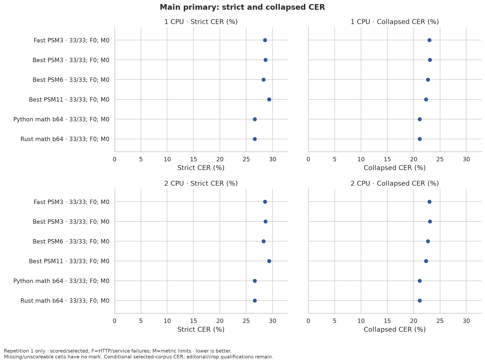
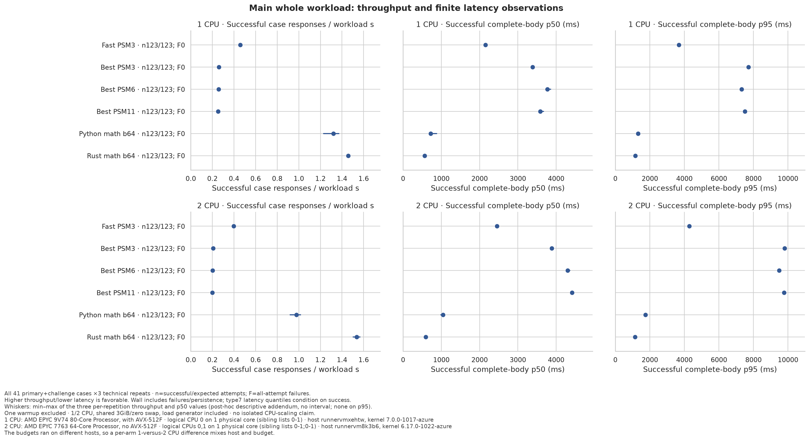
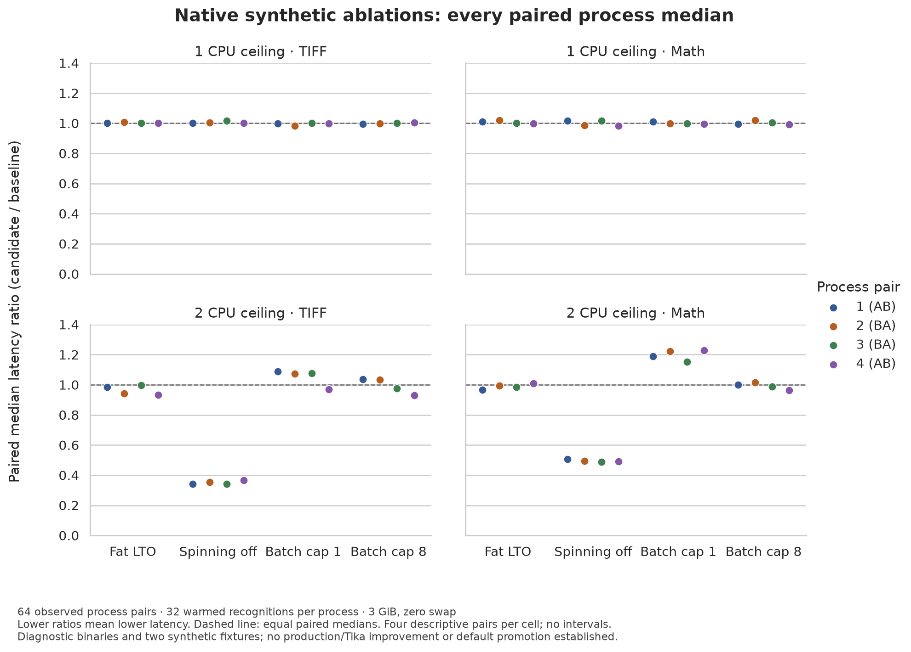

# Tika 3.3.2 with native Indra OCR

A bounded Rust OCR service and an executable adapter that stands in for the Tesseract command line of **Apache Tika 3.3.2**. Tika parses documents and renders PDF pages; the persistent Rust service runs pinned Indra models through ONNX Runtime and OpenCV. Axum/Tokio serve HTTP, dedicated native threads run inference, and a Rust gateway supervises Tika and drains accepted requests before shutdown. The adapter implements only the plain-text command line of the shipped Tika configuration; a request that sets another OCR language, page segmentation mode or output type fails instead of being approximated ([Tika OCR request contract](docs/tika-gateway.md#tika-ocr-request-contract)).

The production OCR path has no Python interpreter. Rust executables are static GNU/glibc builds in `scratch`; Tika uses Debian 13 distroless Java 21. Python Indra remains a separately built comparison arm. No image uses Alpine.

Accepted evidence, failed attempts and pending gates are recorded in [the results ledger](docs/results.md); the stacked reviews and their order are described in [the development guide](docs/development.md#review-order). Nothing is merged automatically.

## Local Docker

Use a Linux/amd64 Docker host with Docker Compose. The application budget is **1 CPU and 3 GiB**, including the JVM parent, forked parser, CLI adapter and OCR service. Image compilation needs additional host resources and time; its two-job policy is separate from inference measurement.

Build from the repository root in dependency order:

```sh
docker buildx build --load --platform linux/amd64 \
  -f docker/bridge.Dockerfile -t indra-bridge:dev .
docker buildx build --load --platform linux/amd64 \
  -f docker/gateway.Dockerfile --target gateway -t indra-gateway:dev .
docker buildx build --load --platform linux/amd64 \
  -f docker/native.Dockerfile --target server -t indra-native:dev .
docker buildx build --load --platform linux/amd64 \
  -f docker/tika.Dockerfile -t tika-indra:dev .

docker compose up -d --no-build --wait --wait-timeout 600
curl --fail-with-body http://127.0.0.1:9998/readyz
curl --fail-with-body \
  -H 'Accept: text/plain' -H 'Content-Type: application/pdf' \
  --data-binary @document.pdf -X PUT http://127.0.0.1:9998/tika
```

Native dependency compilation defaults to affinity `0,1`. If those CPU IDs are unavailable, pass `--build-arg BUILD_CPUSET=YOUR_ALLOWED_IDS`. Cargo uses two build jobs, which does not enforce a CPU quota or affinity; [native build documentation](docs/native-build.md) explains the recorded inputs and resource scope. Builds download pinned dependencies. The `models-init` service populates a named model volume with verified files. Serving mounts that volume read-only and fails on missing or corrupt models; it never downloads during an OCR request.

Only Tika's gateway is published, on host loopback. Java listens privately on port 9999 and OCR on port 8081 in the shared network namespace. `/readyz`, `/startupz` and `/healthz` describe lifecycle; `/tika` and `/rmeta/text` retain Tika's parsing endpoints. The native service exposes generated OpenAPI at `/openapi.json` inside the namespace.

Select the 2-CPU profile by replacing the running stack:

```sh
docker compose down
docker compose -f compose.yaml -f compose.2cpu.yaml \
  up -d --no-build --wait --wait-timeout 600
docker compose -f compose.yaml -f compose.2cpu.yaml logs --tail=100
docker compose -f compose.yaml -f compose.2cpu.yaml down
```

Do not add `--volumes` when stopping if the verified model cache should survive.

| Application ceiling | Tika / gateway | Native OCR | Memory |
|---|---:|---:|---:|
| 1 CPU | 0.25 CPU | 0.75 CPU, one ORT/OpenCV thread | 1 GiB + 2 GiB |
| 2 CPUs | 0.50 CPU | 1.50 CPUs, two ORT/OpenCV threads | 1 GiB + 2 GiB |

Both profiles use one persistent OCR worker, bounded admission, FP32 models, runtime CPU dispatch and math recognition enabled. Math is an accuracy option with additional work, not a measured universal best setting. For text-only deployments, set `INDRA__ENGINE__MATH=false` and keep the fetch/verify/serve model selection consistent. These fixed container partitions cannot borrow each other's unused quota. The scientific comparison separately uses one verified parent cgroup for **Tika, OCR and the Rust load generator**, with 1/2 CPUs and 3 GiB total, zero swap, equal rendering policy and recorded throttling.

## Kubernetes

The deployment requires restartable init sidecars, stable since Kubernetes **1.33**, Linux/amd64 nodes and a default storage class for the 1 GiB model PVC. The recorded lifecycle gate uses the pinned Kubernetes **1.36.4** toolchain. The deployment contains an ordinary model-download init container, a restartable OCR init sidecar, and the main Tika/gateway container. The OCR startup probe completes before Tika starts. Kubernetes [stops the main container before its restartable sidecar](https://kubernetes.io/docs/concepts/workloads/pods/sidecar-containers/#sidecar-containers-and-pod-lifecycle), so accepted Tika parses retain their OCR dependency during draining. The configured 450-second grace covers both bounded shutdown phases.

Load `indra-native:dev` and `tika-indra:dev` into your local cluster, or replace both image names with **verified immutable release digests** in a Kustomize overlay. Then apply one profile:

```sh
kubectl apply -k deploy/overlays/1cpu
kubectl rollout status deployment/tika-indra --timeout=600s
kubectl port-forward service/tika-indra 9998:9998
```

Use `deploy/overlays/2cpu` for the larger profile. The deployment has one replica and a `Recreate` strategy, so updating does not temporarily double the application budget. This entails an availability gap. Pods use non-root identities, read-only roots, bounded temporary volumes and no service-account token. [The deployment source](deploy/base/deployment.yaml) is the exact operational contract; [the service guide](docs/runtime-service.md) covers deadlines, overload, probes and errors.

## What is implemented

| Area | Behavior and evidence |
|---|---|
| Model cache | Explicit fetch/verify commands; immutable revision, file sizes and SHA-256; atomic publication; offline serving |
| Admission and shutdown | Fixed-capacity queue and payload leases; draining makes readiness fail and closes admission; accepted work retains ownership through the final response bytes |
| Inference | Pinned FP32 Indra pipeline, dynamic width-aware line batches, bounded tensor arenas, real Python/Rust intermediate and text parity |
| Configuration | `config` + Clap; defaults → explicit TOML → environment → flags; unknown fields rejected; safe Miette diagnostics; debug-only dotenv |
| Observability | Contextual JSON tracing, real OTLP protobuf traces/metrics, contextual Sentry envelopes, redaction and bounded exporter shutdown; wire-tested |
| API | Axum handlers and Utoipa OpenAPI; finite typed errors, shell-free probe/drain/completion commands |
| Packaging | GNU static executable checks, scratch/distroless runtime stages, source/relink materials and component notices |
| Verification | Lifecycle/process tests, exact output fixtures, tensor parity, standalone allocation counters, Criterion and a Creusot batch-plan proof |

The default worker batches lines within a document. An [opt-in two-owner pilot](docs/continuous-batching.md) shares real classifier/recognizer calls across requests while preserving each complete reference group’s padded width. Its [240-cell paired native/Tika study](https://github.com/somehowchris/tika-indra-ocr-client/blob/1f9d4d7b1185331189daec230fa7a34343258f4e/evaluation/continuous/evidence/2026-10-19-pilot/README.md) admits 2,880 exact responses but fails the predefined performance screen: complete-Tika throughput is lower in every tested stratum. It remains disabled. A separate [same-age math-row compaction experiment](docs/math-compaction-experiment.md) passes numerical/output gates but includes two-CPU regressions and stays opt-in; fresh-row refill in the autoregressive graph still needs its own cache/position policy. The Tika source overlay carries request-scoped W3C context across the subprocess boundary; [the tracing gate](https://github.com/somehowchris/tika-indra-ocr-client/blob/1f9d4d7b1185331189daec230fa7a34343258f4e/validation/tracing/2026-10-18/README.md) retains the actual wire evidence and its diagnostic-image qualification.

## Evidence and comparison

The earlier signed-container study measured Tesseract against **Python Indra** on 15 mostly English synthetic fixtures, at two CPU limits and two quota policies. It is historical engineering evidence, not the requested multilingual quality result and not a Rust-engine comparison.


The new frozen study has 33 primary pages in 19 document clusters, plus eight separately reported challenge cases. English accounts for fewer than 10% of primary pages, clusters and reference letters. The main corpus includes public legal, historical, printed, handwritten, mixed-layout and script-specific material, with transcription qualifications and possible training overlap disclosed. A separate two-case Portuguese laboratory-methods supplement is exploratory: two methods-section crops from two published chemistry articles. It contains no laboratory report, result sheet or lab form, and no licensable public set of such pages has been admitted, so no result here covers those documents. Three repeated executions measure runtime variability; they do not triple the statistical sample size.

The frozen study was executed once on a signed candidate. Release run [39810108196](https://github.com/somehowchris/tika-indra-ocr-client/actions/runs/39810108196) (source `92ba8d5`, tag `v0.0.0-validation-20261022-92ba8d5`) completed all 24 cells and 60 paired comparisons on hosted runners. That run concluded failure because its own report render rejected the evidence (`original_page_id`); the report was rendered from the sealed evidence, without re-measuring, by run [39837656304](https://github.com/somehowchris/tika-indra-ocr-client/actions/runs/39837656304) with the report code of `3ef7e08`. On the 33 primary pages, Rust Indra and Python Indra read identically: strict CER 26.59% and whitespace-collapsed CER 21.11% at both CPU budgets. The four Tesseract settings score 28.30–29.33% strict and 22.32–23.07% collapsed. The paired strict-CER difference of either Indra arm against fast PSM3 is −1.98 percentage points with a document-cluster bootstrap interval from −5.89 to +1.09, which crosses zero: favourable, not a demonstrated superiority. Every one of the 123 attempts per cell succeeded. On the two laboratory crops, all four Tesseract settings score below Indra's 2.08% strict CER: 0.76–0.80% for best PSM3, best PSM6 and fast PSM3, and 1.98% for best PSM11.



At 1 CPU the Rust arm answers 1.46 successful case responses per workload second (median complete-body latency 567 ms) against 1.32 for Python Indra (721 ms) and 0.25–0.46 for Tesseract (2.2–3.8 s). At 2 CPUs it answers 1.54 against 0.98 and 0.20–0.40. The two budgets ran on separate hosted runners, so this is not a CPU-scaling claim. Each budget's six arms share one host. These numbers describe one CPU budget shared by Tika, OCR and the load generator; the fixed OCR/Tika partitions of the shipped Compose and Kubernetes profiles above were not measured.



The paired, challenge, strata and laboratory figures, the plot validation and the [visual-review receipt](evaluation/figures/frozen-study-visual-review.json) bound to these exact bytes are under [evaluation/figures](evaluation/figures); the exported tables and study index behind every number are under [evaluation/results/frozen-study-20261022](evaluation/results/frozen-study-20261022/README.md); the ledger rows are in [results](docs/results.md).

The [completed native profiles](https://github.com/somehowchris/tika-indra-ocr-client/blob/1f9d4d7b1185331189daec230fa7a34343258f4e/tests/evidence/2026-10-18-native-profile-baseline/README.md), [math experiment](https://github.com/somehowchris/tika-indra-ocr-client/blob/1f9d4d7b1185331189daec230fa7a34343258f4e/runtime/validation/math-compaction/2026-10-18/paired-study/README.md) and [one-factor ablations](runtime/validation/native-ablations/2026-10-18/README.md) use synthetic implementation fixtures. They are separate from multilingual quality and complete-Tika performance. All three ran before the Indra 1.1 port, with the pre-1.1 model set `ed345c7f` (indra-ocr 0.3.2); the ablations ran on the local Ryzen 9 7950X3D host in symbol-preserving diagnostic executables, not the stripped release binaries. The 1.1 study carries their kept defaults (batch cap 64, spinning on, thin LTO) over without re-measuring them, and the release profile's choice of thin LTO rests on these diagnostics alone ([scope](docs/native-ablations.md)). Neither lower decoder work nor a favorable diagnostic ratio proves a production improvement.



Each mark is one fresh process pair; lower ratios mean lower median latency. The two-CPU spinning-off results merit a separate representative-workload test. None of these historical four candidates met the frozen across-quota promotion rule or was promoted. [Raw evidence and analysis](runtime/validation/native-ablations/2026-10-18/README.md), [Seaborn source](evaluation/report/native_ablations.py) and [numeric/visual review](evaluation/figures/native-ablations-visual-review.json) are retained.

The six retained configurations compare four pinned Tesseract model/layout settings, Python Indra with math, and Rust Indra with math through matched Tika rendering. Both Indra arms run the one configuration fixed by the owner decision recorded in the [Indra 1.1 amendment](evaluation/audits/indra-1-1-20261020/amendment.json): model `bd02167f` (v1.1.0, indra-ocr 1.1.2), math on, FP32, LM beam search, dual-read routing, batch 64 and one worker. The study does not vary Indra settings. Quality uses strict NFC character error rate, a secondary whitespace-collapsed view, explicit failures and document-cluster paired resampling. Performance reports complete-body latency and successful **case responses per complete workload second**. Full pages and oracle crops are identified separately. See [the frozen protocol](evaluation/protocol.json), [corpus manifest](evaluation/corpus-frozen.json), [report](evaluation/report/report.qmd) and [results](docs/results.md).

## Releases and licenses

Release workflows pin actions and external tools, produce candidate digests, exercise the actual runtime images, and bind keyless Cosign signatures, SPDX SBOMs (with the Rust dependency tree embedded by cargo-auditable and the statically linked glibc and libgcc of every static executable, including the gateway and bridge inside the Tika and Tesseract images; the native image adds libstdc++, ONNX Runtime, OpenCV, Intel IPP ICV and OpenCV's libjpeg-turbo, libpng, libtiff and zlib) and retained execution evidence to those digests. Use a completed release's artifact and exact workflow identity; a workflow file or mutable image tag is not evidence that a candidate passed. Verify before deploying:

```sh
cosign verify ghcr.io/somehowchris/tika-indra-native@sha256:DIGEST \
  --certificate-oidc-issuer https://token.actions.githubusercontent.com \
  --certificate-identity-regexp '^https://github.com/somehowchris/tika-indra-ocr-client/\.github/workflows/release\.yml@refs/(heads/main|tags/v[^/]+)$'
cosign verify-attestation --type spdxjson ghcr.io/somehowchris/tika-indra-native@sha256:DIGEST \
  --certificate-oidc-issuer https://token.actions.githubusercontent.com \
  --certificate-identity-regexp '^https://github.com/somehowchris/tika-indra-ocr-client/\.github/workflows/release\.yml@refs/(heads/main|tags/v[^/]+)$' \
  | jq -r '.payload | @base64d | fromjson | .predicate.packages[].name'
```

The [deployment guide](docs/container-deployment.md#verify-signed-images-before-deploying) shows the same check for every role and the Kustomize digest overlay. The native release is a separate gate from the previously signed Python baseline. Hosted scientific execution is an explicit release-workflow option; the same signed candidates can be measured with the local Docker controller under the [recorded execution method](https://github.com/somehowchris/tika-indra-ocr-client/blob/1f9d4d7b1185331189daec230fa7a34343258f4e/evaluation/audits/local-docker-execution-0001.json). [Results](docs/results.md) records which run and source actually passed.

The adapter and Rust code are Apache-2.0. Indra code and model weights have different licenses. Review the [exact pinned weights license](https://huggingface.co/datalab-to/indra-ocr/blob/bd02167fdf2005a19962cc15188f8496a2c87d3b/LICENSE), including its commercial thresholds and other conditions, for your use. Static GNU redistribution also includes glibc source/relinking materials and native dependency notices; see [third-party notices](THIRD_PARTY_NOTICES.md) and [relinking](docs/relinking.md).

## Development and references

The [implementation roadmap (#13)](https://github.com/somehowchris/tika-indra-ocr-client/issues/13) links the scoped architecture, research and implementation issues; each names dependencies, technical requirements, exclusions and required evidence.

Start with [local Rust development](docs/development.md). Detailed guides cover the [architecture](docs/design.md), [native dependency build](docs/native-build.md), [engine/parity](docs/native-engine.md), [service operations](docs/runtime-service.md), [batch proof](docs/batch-proof.md), and [primary-source research](research/indra-findings.md). Exact dependencies are recorded in Cargo locks, Dockerfiles, [deployment dependencies](deploy/dependencies.lock.json), [native build inputs](scripts/native-build-tools.lock) and [model manifest](backend/models.lock.json).
