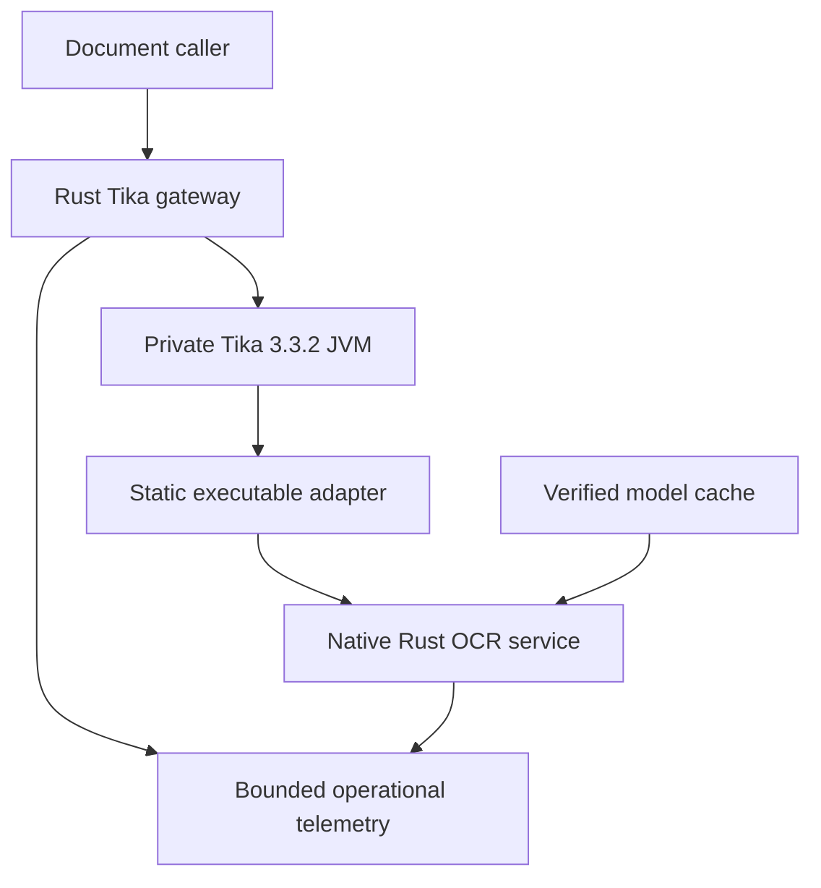

# Architecture and engineering contract

The application replaces Tika's Tesseract executable contract while keeping **Tika 3.3.2** responsible for parsing, embedded-document traversal and PDF rasterization. The OCR service is a persistent native Rust process. It verifies an immutable local model snapshot, warms all configured workers, admits bounded requests and exposes readiness only when it can perform OCR. The separately packaged Python service is a comparison reference.

## Modules and boundaries

| Component | Responsibility | Ownership boundary |
|---|---|---|
| Root `indra-tesseract` package | Implement the Tesseract CLI subset Tika invokes; stream encoded image bytes and validated UTF-8 output | One bounded transfer; no dependency on the HTTP/native runtime workspace |
| `indra-gateway` | Public Axum endpoint, bounded Tika requests, Java process-group supervision and ordered drain | Own Java lifetime and retain admission until response bytes are released or the parser group is reaped |
| `indra-server` | Configuration, probes, API, bounded upload/queue/response ownership and native-worker supervision | Lease follows the input through upload, queue, synchronous inference and final response |
| `indra-engine` | Image decode, segmentation, reading order, script/CTC recognition and optional math decoding | Preallocated bounded storage and concrete native types; sessions stay on dedicated threads |
| `indra-core` | Admission/drain transitions, fixed-capacity FIFO and checked batch-work planner | Small deterministic operations with independent allocation/proof evidence |
| `indra-models` | Explicit acquisition and read-only verification of a pinned model revision | Verify size/hash before atomic publication; serving never downloads |
| `indra-telemetry` | Contextual tracing, real OTLP/Sentry transport, finite labels, redaction and bounded flush | Export queues cannot expand request admission or retain document payloads |
| `evaluation/runner` | Frozen input preparation, request journals, Unicode scoring, paired comparisons and performance extraction | Immutable file identities and explicit missing/failed attempts; no serving dependency |

Java's private listener and the OCR listener are inside one network namespace. The gateway is the public admission point. The model initializer runs before serving and is not part of a warm inference measurement. There is no external broker, model registry service, GPU requirement or Python dependency on the production OCR path.

## Admission, readiness and shutdown

Readiness means the process has completed required startup and is accepting work. Temporary queue saturation is a request-level overload response; it does not oscillate readiness. Draining removes readiness and rejects new admission before waiting for accepted work. Liveness remains separate. A client's cancellation cannot free storage still in use by a native call or Java parser.

The default OCR service has one worker and three total admission leases: the active native request plus two queued/uploading responses. Limits are fixed and validated. The gateway independently limits active parsing requests and connections, and streams response chunks through a bounded channel. These are memory and ownership contracts, not promises that arbitrary input finishes within an unbounded deadline.

Native computation runs on dedicated OS threads, never inside a Tokio future or a Rayon pool reached from async work. Each worker explicitly reserves an 8 MiB stack: the retained real container failure showed an overflow on the default worker stack. The service rejects obvious worker/thread oversubscription. CPU flags do not enforce quotas; Docker/Kubernetes/cgroup validation does that separately.

The gateway owns the JVM process group and reaps children. If a response ends ambiguously while native/Java work might still run, it keeps the reservation until the process ownership boundary is resolved. A synchronous native call cannot safely be force-unwound; a finite watchdog changes status and terminates the failed process after bounded cleanup.

Compose keeps OCR as the network-namespace owner and stops its dependent Tika container first. Kubernetes uses an ordinary cache init container, then a restartable OCR init sidecar, then the main Tika container. Its native-sidecar termination order keeps OCR available while Tika drains. Do not install an OCR preStop hook that removes this dependency early. The shipped 450-second Pod grace covers both bounded stages. See the [Kubernetes sidecar lifecycle](https://kubernetes.io/docs/concepts/workloads/pods/sidecar-containers/#sidecar-containers-and-pod-lifecycle) and [actual deployment](../deploy/base/deployment.yaml).

## Batching and continuous work

The existing engine dynamically groups width-sorted lines within a document, subject to batch count and tensor-work limits. It pads a batch to the selected maximum width and reuses bounded arenas. The native grouping policy and the aligned memory safety planner are distinct: changing the latter must not silently change membership, order, padding policy or model inputs.

Cross-request continuous batching is not yet implemented. A bounded FIFO does not provide it. A useful next experiment is a small stateless recognition scheduler that combines compatible script/CTC work from at most the already admitted page owners, with a finite wait budget and exact output routing. It must preserve cancellation ownership, reading order, fairness, memory ceilings and the fast path for a single request. Promotion requires mixed short/long workload measurements, not just a larger batch count.

The pinned math decoder takes one scalar position for the batch and uses self-cache tensors shaped `[3, batch, 8, steps, 24]`. Fresh rows of a different decoding age cannot simply reuse completed slots. Completed-row compaction and same-age cohorts are distinct experiments; arbitrary-age refill requires a changed graph/cache contract and new numerical/quality evidence. Existing heterogeneous six-row evidence contains 202 post-completion row steps out of 360. That is redundant row work under this policy, **not a predicted 56.1% latency saving**. See the [math implementation](../runtime/crates/indra-engine/src/math.rs) and [recorded termination evidence](../runtime/crates/indra-engine/tests/evidence/2026-10-18-parity/math-termination.json).

## Rust ownership and allocation policy

Use concrete types and enums, borrowed slices, bounded arrays, checked arithmetic and structured `thiserror` errors. Use `const fn` where it expresses a real compile-time invariant and `static` for shared global values. Avoid application `dyn`, growing `Vec` queues, `clone`/`to_owned` payload duplication, unnecessary `Box`, implicit large-value copies and blanket `anyhow` errors. The workspace lints reject implicit/redundant clones and large pass-by-value types.

These rules must be evaluated at an explicit boundary. OpenCV and ONNX Runtime own internal buffers; decoded image transformations and model outputs have real storage costs. Borrowing an image view, moving a tensor handle and copying pixel data are different operations. Do not assert that the entire process allocates nothing or eliminate an ownership check just to satisfy a lexical search. Track justified native/library allocations separately and measure churn in the operation being changed. The service uses mimalloc; the dependency-free bridge retains its system allocator and separately demonstrates zero heap churn in its streaming control operation.

## ONNX, SIMD and optimization

The build pins ONNX Runtime 1.31.0 and OpenCV 5.0.0 source revisions, tools, downloaded archives and package snapshot. OpenCV uses a portable SSE3 baseline and runtime dispatch through AVX512_SKX; ORT uses its own MLAS dispatch. Disabling a generic build AVX option does not imply every specialized MLAS kernel is absent. IPP is a pinned upstream binary component and must be disclosed as such. No release image is built with host-specific `target-cpu=native`.

One/two CPU profiles use explicit native thread limits and sequential graph execution. ORT spinning can reduce wakeup latency while consuming quota, so it is an ablation rather than an assumed universal improvement. [ORT's thread documentation](https://onnxruntime.ai/docs/performance/tune-performance/threading.html) describes that tradeoff. The release Rust profile uses thin LTO, one codegen unit, checked arithmetic and aborting panics; fat LTO is a measured candidate. Profiling builds retain symbols. Source/build flags alone establish no measured throughput claim.

## Configuration, API and observability

`config` and Clap merge defaults, an explicitly named TOML file, environment and flags, in that order. Typed validation rejects unknown fields and incompatible limits before startup. Miette diagnostics show safe paths and types without echoing credentials. Dotenv is debug-only. Cache fetch/verify, configuration checking, OpenAPI generation, shell completion and probe/drain commands work without a runtime shell.

Tracing covers admission, queue time, model startup, native stages, worker identity, batch width/padding and finite error classes. OTLP exports real protobuf traces and metrics; Sentry emits contextual incidents for terminal failures. Wire tests inspect these payloads and their redaction. External exporters are bounded and do not see images, OCR text, filenames, authentication headers or arbitrary baggage. Java's subprocess boundary currently interrupts automatic gateway-to-OCR trace propagation; completing that path must use request-scoped context, never process-global environment mutation.

## Static packaging and evidence

The Rust runtime stages are scratch; Java and the Python reference use digest-pinned Debian distroless images. No Alpine stage is permitted. A build gate inspects every shipped executable for absent `PT_INTERP` and `DT_NEEDED`, executes the actual artifact, and retains exact source/relink materials and third-party notices. Static GNU deployment still requires explicit trust stores and licensing materials.

Release verification must distinguish an OCI index, selected platform manifest, config and the identity Docker records on the created container. Compare the verified descriptor chain rather than assuming every Docker `.Id` or `.Image` is the same kind of digest. Candidate tags are discovery aids; immutable digests, bounded signature verification, decoded attestation predicates and retained gate records establish what was executed and signed.

## Verification boundaries

[Creusot](https://creusot.rs/) proves the batch planner's specified arithmetic/state contract. It does not prove native libraries, all scheduler behavior, lifecycle or OCR accuracy. Native stage parity proves agreement with the pinned reference on its declared fixtures. Process tests prove their exercised lifecycle transitions. Scientific quality and performance require the separately frozen corpus and aggregate cgroup measurement. Each result records its own source revision, inputs, scope and limitations in [the results ledger](results.md).
