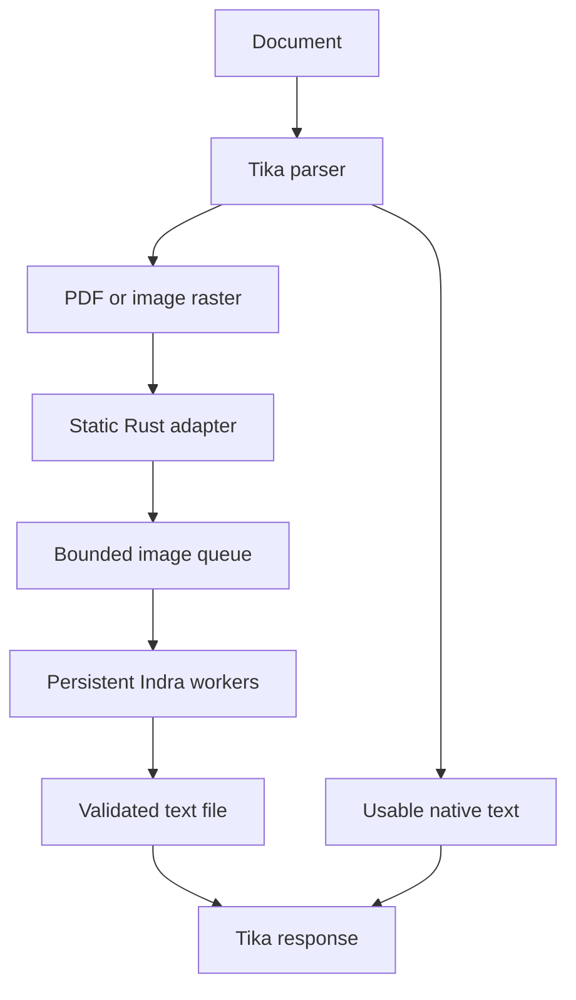

# Design and implementation decisions

## Selected integration

Keep Apache Tika 3.3.2 and its document-format coverage. Replace only the executable invoked by `TesseractOCRParser`: a small Rust program accepts the exact configured Tika CLI, uploads a rendered image to a resident Indra worker, validates the complete response, and writes the output file Tika expects.



This preserves the upstream OCR pipeline while avoiding model loading for every page. It delivers plain text through Tika. Indra's structured JSON boxes, confidence data, HTML tables and Markdown are not exposed by this narrow compatibility interface. Adding them should use an explicit metadata/schema extension rather than pretending plain text preserves that structure.

### Alternatives evaluated

| Approach | Benefits | Cost or limitation | Decision |
|---|---|---|---|
| Keep Tesseract with `tessdata_best` | Mature language models; smallest change | Baseline CPU/latency cost; workload-dependent quality | Retained as a real comparison and rollback path |
| Point Tika directly at `indra-ocr` | Superficially simple | Different CLI/output contract; repeated process/model initialization | Incompatible without an adapter |
| Rust CLI adapter + resident upstream Indra | Small, reviewable change; preserves inference behavior; model reuse | Process and loopback transport overhead; text-only integration | Implemented |
| Custom Java Tika parser | Can publish structured metadata and use Java HTTP pooling | Additional Tika plugin lifecycle, packaging and compatibility surface | Consider when boxes/layout become a requirement |
| Route PDFs directly to Indra's converter | Native text/hybrid path and upstream page scheduling | A second document-routing architecture; changes extraction semantics | Separate future evaluation |
| Rewrite detection, geometry, recognition and layout in Rust | Potentially one native service and fewer boundaries | Large parity burden; ORT/native code still needs packaging; no measured speed benefit yet | Not justified by current evidence |
| Cross-request crop batching | May improve utilization on large deployments | Requires detection/crop queueing, fair deadlines, result scattering and independent accuracy checks | Not implemented or claimed |

The upstream [pipeline](https://github.com/datalab-to/indra/blob/3d773aeedc5d79d1d0a2a04007a9075cd71a59f4/indra_ocr/pipeline.py), [document conversion](https://github.com/datalab-to/indra/blob/3d773aeedc5d79d1d0a2a04007a9075cd71a59f4/indra_ocr/document.py) and [parallel execution](https://github.com/datalab-to/indra/blob/3d773aeedc5d79d1d0a2a04007a9075cd71a59f4/indra_ocr/parallel.py) support the capability distinctions above. The decisions are engineering judgments, not measured rankings of unimplemented alternatives.

## Exact Tika contract

The configured invocation is:

```text
/opt/indra/tesseract INPUT OUTPUT_BASE --psm 3 -c page_separator= -c preserve_interword_spaces=0 txt
```

The executable writes `OUTPUT_BASE.txt`. Returning text only on stdout does not satisfy Tika. The availability probe invokes the executable without arguments; that probe succeeds locally without requiring an already-running backend. Actual readiness is a separate check.

Set `language` to an empty string, `preloadLangs=false`, `outputType=txt`, `pageSegMode=3`, `enableImagePreprocessing=false`, and `applyRotation=false`. Indra applies its own layout/orientation path. The bridge rejects language hints, unsupported page modes, hOCR and unimplemented flags rather than silently accepting different semantics. The supported interface intentionally follows the inspected [Tika 3.3.2 OCR parser](https://github.com/apache/tika/blob/b8a6916eab70ccdb5d4551c69be1a46af29c2cff/tika-parsers/tika-parsers-standard/tika-parsers-standard-modules/tika-parser-ocr-module/src/main/java/org/apache/tika/parser/ocr/TesseractOCRParser.java).

The two accepted `-c` defaults are compatibility tokens, not configurable Indra layout controls. Indra determines word/paragraph spacing; its multi-frame TIFF API retains `\n\f\n` between frames even though Tika's Tesseract invocation supplies `page_separator=`. Treat exact whitespace and page delimiters as an explicit output difference and use the strict scores when those bytes matter.

The XML timeout property is `timeout`, measured in seconds. The implemented ordering is backend **60 s**, bridge **70 s**, Tika OCR **75 s**, and Tika task watchdog **300 s**. Keep `noFork=false`: the watchdog can replace a stuck parser process. Backend deadlines terminate a stuck native worker, and unsuccessful replacement or idle-child death makes the supervisor exit nonzero. Readiness alone would only remove traffic.

The bridge streams at most 20 MiB of encoded input and accepts at most 4 MiB of UTF-8 text. Headers are bounded to 16 KiB. It requires a successful, length-delimited plain-text response, rejects malformed/truncated responses, and creates a new output file only after full response validation. Existing output is never overwritten. A correctly recognized blank page can produce a successful empty file; an error cannot be converted into that success case.

### PDF semantics

Production uses Tika AUTO with its `better` heuristic. In the inspected source, OCR is triggered for very little native text or many unmapped Unicode characters. A mixed page with sufficient native text can still leave text embedded inside a scanned region unrecognized. Benchmark configuration forces `ocr_only` and holds rendering at 300-DPI grayscale for both engines. Full-page and inline-image OCR are not enabled together, avoiding duplicate extraction. See [PDF configuration](https://github.com/apache/tika/blob/b8a6916eab70ccdb5d4551c69be1a46af29c2cff/tika-parsers/tika-parsers-standard/tika-parsers-standard-modules/tika-parser-pdf-module/src/main/java/org/apache/tika/parser/pdf/PDFParserConfig.java) and [PDF processing](https://github.com/apache/tika/blob/b8a6916eab70ccdb5d4551c69be1a46af29c2cff/tika-parsers/tika-parsers-standard/tika-parsers-standard-modules/tika-parser-pdf-module/src/main/java/org/apache/tika/parser/pdf/AbstractPDF2XHTML.java).

Tika processes full-page OCR synchronously. One multi-page PDF does not automatically feed concurrent page requests to this service. To exercise two backend workers, send independent documents concurrently. Indra's own `convert_many` page scheduler is a different integration path.

`/rmeta/text` can return HTTP 200 while metadata contains `X-TIKA:EXCEPTION:container_exception`; clients must inspect exception and write-limit fields. A successful process that fails to create its output can also produce empty extraction. These cases were checked against the real 3.3.2 server with labelled contract stand-ins; the smoke script verifies actual content as well as status. `pdf:ocrPageCount` counts attempts and is not sufficient proof that the backend completed OCR.

## Accuracy and batching

The default profile explicitly keeps FP32 recognition, orientation, script selection, adaptive detection, reading order and every published standard model. The pinned snapshot has no released `rec.int8.onnx` or `mask.onnx`; neither is invented as a performance feature. The backend checks the exact manifest at startup and fails on missing or modified models.

Indra batches line crops of the same recognition group and similar width. Ordinary recognition uses tensors `[B,1,32,W]` with width aligned to eight and at most 64 lines. Grouping treats widths below 64 as 64, limits their ratio to 1.3, and checks `count × max(width, 64) ≤ 40,960`. The 64-pixel floor applies to grouping, not tensor width; final alignment can add up to seven columns per line beyond the grouping estimate. Short pages often yield batches much smaller than 64. The queue and two worker processes do not fuse independent requests. [Batch construction](https://github.com/datalab-to/indra/blob/3d773aeedc5d79d1d0a2a04007a9075cd71a59f4/indra_ocr/rec_preproc.py)

`INDRA_BATCH_METRICS=1` records actual tensor shapes, useful versus padded columns, stage times, queue time and worker identity. Compare `INDRA_RECOGNITION_BATCH=1` with 64 on identical inputs. Instrumentation has cost and is labelled in the results. Never call a queue-size increase an inference batching improvement.

`INDRA_MATH=1` enables the extra models already included in the locked image. It may improve formula extraction while altering ordinary numeric/table text and increasing latency. Correctly loading the math profile is distinct from proving mathematical transcription accuracy. The publisher's [math implementation and release results](https://github.com/datalab-to/indra/blob/3d773aeedc5d79d1d0a2a04007a9075cd71a59f4/CHANGELOG.md) support testing this profile separately.

OCR scripts are Latin, Cyrillic, Greek, Devanagari, Bengali and Chinese. Existing PDF text can cover more scripts, which is not evidence of OCR support. Handwriting, vertical text, degraded pages and complex tables need explicit acceptance slices. A global CER can hide a complete failure for a small language group. See the [checked language/limitation report](../research/indra-findings.md).

## Rust performance and static linkage

The Rust code uses a concrete error enum and statically resolved generic parameters. It contains no `dyn`, `.clone()` or `.to_owned()`, has no third-party crates, forbids unsafe code and denies the relevant Clippy lints. This source-level property is not a claim that the standard library or native OCR stack has no allocations or copies.

| Boundary | Deliberate memory work |
|---|---|
| CLI and file paths | Owned OS argument/path buffers moved into the command |
| Image upload | Bounded streaming via `io::copy`; no full image buffer in Rust |
| Response | One bounded response vector, validated as borrowed UTF-8 before file creation |
| HTTP parsing | Reused bounded header-line storage and an 8 KiB buffered reader |
| Python worker | Encoded-body buffering and explicit process IPC; NumPy views the compressed bytes |
| OCR model | Image decoding, crop resizing/padding and native inference allocations |

`release` uses optimization level 3, thin LTO, one codegen unit, panic abort, stripped symbols, no incremental compilation and retained overflow checks. `maxperf` changes only to fat LTO and is a measured candidate, not a universal speed claim. `profiling` retains symbols. Build the static GNU target on Debian:

```sh
RUSTFLAGS='-C target-feature=+crt-static' \
  cargo build --locked --offline --jobs 2 --release --target x86_64-unknown-linux-gnu
python3 scripts/check_static.py target/x86_64-unknown-linux-gnu/release/indra-tesseract
```

The ELF gate requires both no `PT_INTERP` and no `DT_NEEDED`; the tool executions must themselves succeed. A static PIE can still have ELF type `DYN`. The release binary was also executed as UID 65532 inside a filesystem containing only that executable. The [Rust linkage reference](https://doc.rust-lang.org/reference/linkage.html#static-and-dynamic-c-runtimes) explicitly recommends inspecting the generated artifact; [Cargo profiles](https://doc.rust-lang.org/cargo/reference/profiles.html) define the optimization controls.

Only the Rust adapter is a fully static executable. The supported Indra Python/ONNX runtime and Tika JVM are dynamic glibc runtimes inside distroless. Rebuilding the entire model/document stack as static Rust would be a separate port. No Alpine-based images or alternative libc toolchains are used by the authored build paths.

Static glibc also changes redistribution packaging. The bridge image includes `/relink`: the exact installed glibc source package and Debian patches, application source/build files, notices and hashes. Tika copies that directory and the baseline inherits it. This costs additional image bytes; the measured 1.23-MB figure refers only to the native bridge executable. The source collector rejects mismatched archives. See [relinking instructions](relinking.md) and [third-party notices](../THIRD_PARTY_NOTICES.md); this bundle does not replace the model license or every native dependency's terms.

`target-cpu=native`, PGO, alternate allocators, quantization and alternate execution providers are not enabled speculatively. The bridge is dominated by process/file/transport work; meaningful optimization needs measured service-level benefit and unchanged text. A native CPU target also narrows where the resulting artifact can run.

## CPU and memory budgets

The standard Compose/Kubernetes profiles use per-container CPU ceilings whose sum is one or two. Tika's budget includes the Java parent, forked parser and Rust children; Indra's includes the Python parent and all model workers. Requests equal limits in the basic Kubernetes manifests. Memory is 1 GiB for Tika and 2 GiB for Indra, matching the baseline's total 3 GiB.

Hard partitions simplify accounting but can waste idle capacity: during OCR, Indra cannot borrow Tika's unused quota. The native affinity experiment gives both processes the same eligible CPU set, so its timings do not predict those partitions exactly. The signed-image benchmark wrapper records leaf cgroup counters and can use a preconfigured shared parent budget; it never adds parent and child counters together. [Docker CPU controls](https://docs.docker.com/engine/containers/resource_constraints/) and [Kubernetes resource accounting](https://kubernetes.io/docs/concepts/configuration/manage-resources-containers/) define these distinctions.

Kubernetes also offers Pod-level CPU budgets through `PodLevelResources` (beta since 1.34, enabled by default in current documentation). This can let containers share idle resources under a single total limit. It is a worthwhile comparison on a cluster that supports it, with container CPU limits removed and the Pod limit retained. Cluster admission can modify resources, so inspect the admitted Pod and actual cgroup. The portable base manifests do not depend on that feature or claim its performance without a cluster run.

For one CPU, one Indra worker with one intra-op thread avoids thread oversubscription. At two CPUs, compare **two workers × one thread with two requests** against **one worker × two threads with one request**. The latter may improve individual latency while the former targets throughput; both can also lose to the one-CPU profile on a constrained or variable host. Explicit OpenMP/BLAS/OpenCV/ORT counts matter because CPU-count discovery and session spinning do not implement a whole-stack quota. [ORT threading](https://onnxruntime.ai/docs/performance/tune-performance/threading.html)

The Tika parent heap is capped at 128 MiB, the parser heap at 512 MiB, and its temporary filesystem at 256 MiB. These do not sum to a safe universal memory bound: native libraries, thread stacks, page rendering and file cache consume additional memory. Indra's 25-million decoded-pixel limit is aggregate across at most 16 TIFF frames; it is not an original-PDF page or byte limit.

The backend admission queue cannot bound requests already accepted and rendered by Tika. Start with caller concurrency one, measure two in the 2-CPU profile, and impose original-document size/page limits in the submitting application or ingress. A memory cap provides an enforcement boundary, not a guarantee against OOM for every valid input. No unverified Tika HTTP concurrency property is presented as a fix.

## Release supply chain

Images and model files are pinned independently. Python dependencies use package hashes and binary-only installation. Debian packages come from a fixed signed snapshot; disabling snapshot expiry checking does not disable signature verification. Runtime model download is disabled. These controls provide traceability; they do not claim byte-for-byte reproducible container builds.

CI runs Rust checks, backend/benchmark invariants, image builds, Compose checks and a real kind deployment. Each final image executes its relevant native startup check during its build. Pushes to `main` and version tags invoke that same CI before publishing candidates. The release workflow tests the exact published candidate digests in Compose and Kubernetes at both CPU budgets before signing. The Kubernetes gate records admitted resources and actual cgroup-v2 CPU and memory ceilings, image IDs, UID/GID, read-only roots and memory-backed temporary storage. The control plane and smoke client are outside the application budget; this gate makes no throughput claim. The workflow uses least-privilege job permissions, full action SHAs, GitHub OIDC, Cosign, host Syft and BuildKit provenance. A failed gate prevents signing. See [GitHub hardening](https://docs.github.com/en/actions/security-for-github-actions/security-guides/security-hardening-for-github-actions), [Docker attestations](https://docs.docker.com/build/ci/github-actions/attestations/) and [Cosign container signing](https://docs.sigstore.dev/cosign/signing/signing_with_containers/).

Action pinning does not replace ongoing updates. Dependabot opens proposed changes; rerun correctness, model-integrity, differential-output and resource tests before accepting an update. Protect release tags in repository policy. Verification must match the exact workflow identity and issuer, not a permissive identity regular expression.
