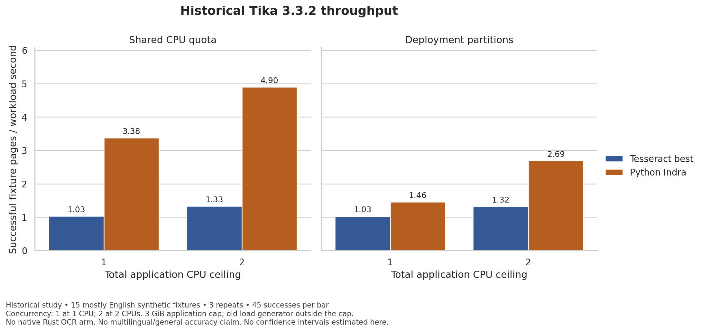
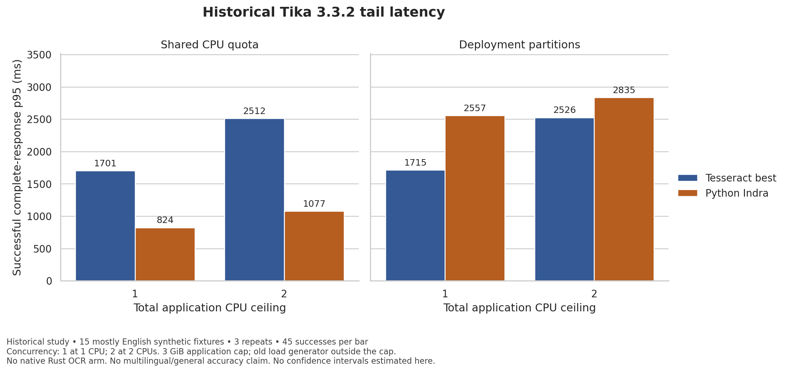

# Results and current acceptance ledger

Updated 18 October 2026. This ledger separates accepted evidence from implemented but unexecuted work. The [historical baseline document](legacy-results.md) is preserved for its producing revisions; it is not the current native acceptance status.

## Native runtime and lifecycle

| Gate | Producing revision / run | Result and scope |
|---|---|---|
| Static native dependency build | [39086092581](https://github.com/somehowchris/tika-indra-ocr-client/actions/runs/39086092581) | Passed pinned GNU native compilation and recorded archives/build inputs |
| Native Indra output/stage parity | [39092252965](https://github.com/somehowchris/tika-indra-ocr-client/actions/runs/39092252965), source `9135086` | Passed 14 fresh cases and 850 intermediate tensors; see retained [parity records](../runtime/crates/indra-engine/tests/evidence/2026-10-18-parity/README.md) |
| Strengthened Creusot batch proof | [39146023143](https://github.com/somehowchris/tika-indra-ocr-client/actions/runs/39146023143), tested merge `3d8a39fe`, PR head `9d0f2ec2` | Passed all 16 generated proof files, exact inverse projection and five ordinary tests; [full artifact and receipt](evidence/batch-proof-20261018/receipt.json) |
| Native service at 1/2 CPUs | [39143910423](https://github.com/somehowchris/tika-indra-ocr-client/actions/runs/39143910423), tested merge `cac99b31`, PR head `db645be7` | Passed 12 unit tests and one real native process lifecycle test per CPU setting in scratch containers |
| Rust runtime tests | [39143910642](https://github.com/somehowchris/tika-indra-ocr-client/actions/runs/39143910642), PR head `db645be7` | Passed after isolating allocation counters from libtest's concurrent reporting |
| Native OCR acceptance on current gateway source | [39143910513](https://github.com/somehowchris/tika-indra-ocr-client/actions/runs/39143910513) | Passed; does not substitute for the deployment lifecycle gate |
| Full native Tika deployment | [39143910460](https://github.com/somehowchris/tika-indra-ocr-client/actions/runs/39143910460), tested merge `cac99b31`, PR head `db645be7` | **Failed before the lifecycle harness:** both services became healthy, but Docker's selected platform manifest identity differed from the container's recorded index identity |
| New profiling and native planner integration | [PR 11](https://github.com/somehowchris/tika-indra-ocr-client/pull/11) | Implementation uploaded as draft; proof and Rust checks pass; rebuilt native gates, measurements and visual review remain pending |
| Signed native six-image release | Recovered draft implementation | Not yet demonstrated by a completed native release run |
| Frozen multilingual main/laboratory study | [PR 10](https://github.com/somehowchris/tika-indra-ocr-client/pull/10) plus recovered execution work | Inputs/protocol frozen; full 32-cell measurement and final analysis pending |

The new service receipt retains exact artifact identities, actual pass logs and the deployment mismatch evidence under [recovery-20261018](evidence/recovery-20261018/receipt.json). The earlier failure and controlled diagnostic remain under [native-service-stack-20261018](evidence/native-service-stack-20261018/receipt.json).

### Corrected worker stack failure

Real service acceptance originally aborted while initializing a native worker: its default stack was too small. The worker now explicitly reserves 8 MiB once at startup. The regression child sets `RUST_MIN_STACK=2097152`, so an ambient large-stack environment cannot conceal a missing explicit reservation. The rebuilt service passed native ready/drain/SIGTERM/output checks at both CPU caps. This proves the exercised lifecycle case; it does not establish that 8 MiB is the minimum possible stack or a throughput optimization.

### Remaining deployment identity failure

The retained Docker 29.9.1 inspection reports Tika's selected linux/amd64 manifest as `sha256:c518b5643132a2556ff91afef8b4c9973afdad49a9792c00f8fe6f34688a1eae`; the created container records `sha256:6dcf78ffb53d90f891aca321aa080ab2b51459ce3fd880f8c51aaa34a08d5be1`. The latter is also the repository digest recorded in the image inspection. A strict equality check between different descriptor levels rejected the healthy stack before OCR/drain testing.

The correction must verify the index → selected platform → config chain and bind the actual container to it. Accepting arbitrary tag/repository membership or removing the identity check is not an acceptable fix. Compose and Kubernetes then need fresh accepted-work shutdown runs; neither is inferred from readiness alone.

## What native parity establishes

The retained study compared 850 tensors comprising 163,005,555 elements: 546 tensor checks used exact comparison and 304 used declared numerical tolerances. Values matched exactly in 805 tensors; that wording is not a bitwise identity claim for every floating-point payload. The largest absolute discrepancy was about `1.72e-5` in German reading-order scores and remained within the combined absolute/relative tolerance. All 14 expected text outputs matched the pinned reference.

The math gates include real batch sizes 1, 8 and 64 and heterogeneous termination. The six-row termination fixture uses 360 row steps, of which 158 precede or include row completion. The remaining 202 row steps describe a possible compaction experiment. They do not predict wall-time savings because kernel efficiency, gather/copy work and fixed costs also matter.

## Historical signed-container baseline

The signed release [39080351532](https://github.com/somehowchris/tika-indra-ocr-client/actions/runs/39080351532), source `d6b37bc7623696ab2ee5d62c1f6af6d851438c6c`, compared Tesseract with **Python Indra**, using 15 mostly English synthetic cases and three repetitions. The [retained source summaries and CSV](../evaluation/results/signed-baseline-20261018/provenance.json) are bound to artifact `12119406416`, SHA-256 `a5fc83c8dd98d85db9363246394ea8a11343a4696171ebbbee701a3c75f04065`.

| Quota policy | CPUs | Tesseract responses/s | Python Indra responses/s | Tesseract p95 ms | Python Indra p95 ms |
|---|---:|---:|---:|---:|---:|
| Shared | 1 | 1.029 | 3.379 | 1701 | 824 |
| Shared | 2 | 1.330 | 4.899 | 2512 | 1077 |
| Deployment partitions | 1 | 1.028 | 1.457 | 1715 | 2557 |
| Deployment partitions | 2 | 1.324 | 2.693 | 2526 | 2835 |

Each cell had 45 successes and no HTTP failures. Concurrency was one at 1 CPU and two at 2 CPUs; the old load generator was outside the application's 3-GiB cgroup. The new study includes its load generator inside the common cap. These studies must not be pooled or presented as a native Rust comparison.

The Seaborn source verifies each bar's source row, category, color, position, value and zero baseline. Both standalone charts have been visually inspected. The current [Quarto source](../evaluation/report/report.qmd) renders the historical data and explains the planned analysis; a complete new-matrix notebook and its rendered HTML visual review remain outstanding.

## Frozen quality study and interpretation

The main corpus has 33 primary pages in 19 document clusters and eight separate challenges. Its primary appearance mix is 19 printed, 11 handwritten and three mixed pages. English accounts for two primary pages, one cluster and 51 of 87,515 NFC reference letters: below 10% by each denominator. Public legal, historical, handwriting and script-specific inputs have documented reference qualifications; unknown training overlap and implementation exposure are disclosed.

The two-case Portuguese laboratory supplement remains separate and descriptive. It contains methods crops from two papers, not complete laboratory reports or clinical documents. Its protocol uses zero bootstrap resamples. Recovery of unpublished raw publisher provenance must be resolved by exact hash recovery or an explicit acquisition-only amendment that preserves the original audit trail and frozen evaluation inputs.

The execution/report work must preserve all eight variants × two CPU limits × two cohorts, including failed or unexecuted cells. Strict NFC CER, secondary whitespace-collapsed CER, valid tokenization, failure coverage and paired document-cluster intervals are separate views. Three timing repetitions do not triple the statistical accuracy sample. Performance units refer to successful case responses per complete workload wall second; mixed full pages and oracle crops do not become an undifferentiated primary-page throughput claim.

## Open implementation decisions

Cross-request continuous batching, completed-row math compaction, fat-LTO/ISA/spinning ablations and end-to-end gateway/Java/CLI trace propagation are explicit work items. They are not claimed by the existing FIFO, compiler profiles or inbound telemetry tests. The linked implementation issues define their dependencies, prospective acceptance criteria and exclusions. No result here demonstrates a universal highest-accuracy setting or that every optimization opportunity is exhausted.
